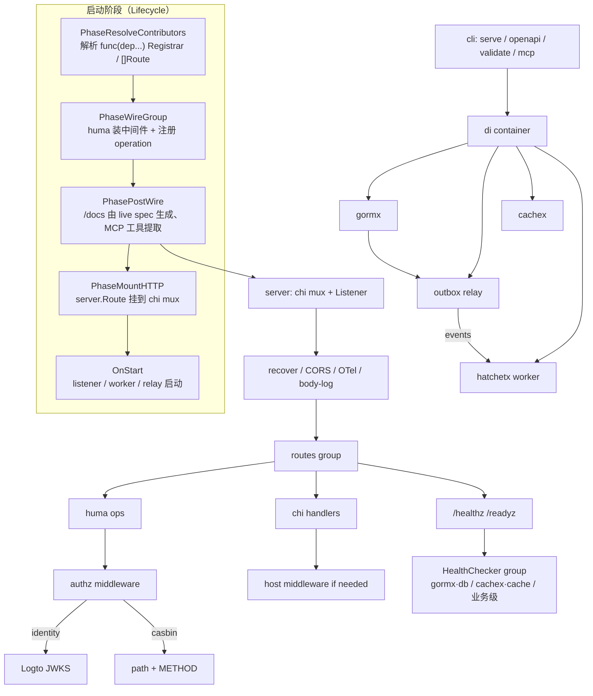

# fxkit 使用文档

`fxkit` 是一套基于 **samber/do/v2**（支持泛型类型安全与生命周期拓扑）的 Go 微服务脚手架：用可组合的 Module 把 HTTP、配置、观测、鉴权、GORM、Hatchet（workflow / cron / events / actor）与事务性 Outbox 装进同一个进程。

> **当前定位**：默认栈**不再依赖 Dapr**。HTTP 由 `server.ListenerModule` 直接监听；异步与定时能力走 **Hatchet**；跨事务发布走 **outbox**。

> **Agent Skills**：可复制到其他项目的 Cursor/Claude skills 见 [`skills/`](./skills/README.md)（覆盖全部主要子包：核心 / Huma+crudx / Hatchet+outbox / authz / otel / consul+reqx / docs）。
>
> **框架维护者**：修改框架本身前先读 [`.agents/skills/fxkit-maintain/SKILL.md`](./.agents/skills/fxkit-maintain/SKILL.md)（不过度设计、不过度防御；改动同步 docs 与 skills）。

---

## 目录

> 第一次使用？先看 **[整体使用指南（docs/guide.md）](./docs/guide.md)**（按使用旅程组织）；
> 本文是分章参考，查具体配置/API 时用。
> 上线前读 **[生产清单（docs/production-checklist.md）](./docs/production-checklist.md)**；
> 暴露公网前读 **[南北向网关（docs/gateway-traefik.md）](./docs/gateway-traefik.md)**；
> 写测试看 **[测试指南（docs/testing.md）](./docs/testing.md)**。

1. [快速开始](#1-快速开始)
2. [模块包一览](#2-模块包一览)
3. [Bundle：Core / Default / Minimal / 自定义](#3-bundlecore--default--minimal--自定义)
    - [启动阶段](#启动阶段)
    - [诊断与自检](#诊断与自检)
    - [严格装配检查（防回退）](#严格装配检查防回退)
    - [健康检查](#健康检查)
    - [ListSpec：map 字面量声明](#listspecmap-字面量声明)
4. [配置参考](#4-配置参考)
5. [HTTP：chi / 路由 / 健康检查](#5-httpchi--路由--健康检查)
6. [Huma REST](#6-huma-rest)
7. [鉴权 authz（JWT + Casbin）](#7-鉴权-authzjwt--casbin)
8. [数据库 gormx](#8-数据库-gormx)
    - [迁移：外部 SQL 平台 + Atlas](#迁移外部-sql-平台--atlas)
    - [缓存 cachex](#缓存-cachex)
9. [列表查询 crudx](#9-列表查询-crudx)
10. [统一错误 fxerrors](#10-统一错误-fxerrors)
11. [事务性 Outbox](#11-事务性-outbox)
12. [Hatchet：事件 / 工作流 / Cron / Actor](#12-hatchet事件--工作流--cron--actor)
13. [可观测性 otelx](#13-可观测性-otelx)
    - [本地日志 logx](#本地日志-logx)
14. [API 文档 docs / openapi](#14-api-文档-docs--openapi)
    - [MCP 服务器（可选）](#mcp-服务器可选)
15. [服务发现 consulx](#15-服务发现-consulx)
16. [脚手架 CLI](#16-脚手架-cli)
17. [脚手架示例](#17-脚手架示例)
18. [安全与运维清单](#18-安全与运维清单)
    - [南北向网关（Traefik）](#南北向网关traefik)
19. [架构示意](#19-架构示意)
20. [升级与迁移](#20-升级与迁移)

---

## 1. 快速开始

> 想看「从零到上线」的完整叙事版，见 **[docs/guide.md](./docs/guide.md)**。

### 安装 CLI

```bash
go install github.com/fitan/fxkit/cmd/fxkit@latest
fxkit init myplatform --module github.com/me/myplatform
cd myplatform
fxkit new hello
make run SVC=hello
```

本地开发（指向本仓库）：

```bash
git clone https://github.com/fitan/fxkit.git
cd fxkit
go build -o ~/bin/fxkit ./cmd/fxkit
fxkit init myplatform --module github.com/me/myplatform --fxkit-path "$(pwd)"
cd myplatform && fxkit new hello && make run SVC=hello
```

### 最小 main

```go
package main

import (
	"github.com/fitan/fxkit"
	"github.com/fitan/fxkit/cli"

	"myapp/internal/hello"
)

func main() {
	cli.SetRootName("myapp", "myapp service")
	fxkit.Run(fxkit.Default(), hello.Module)
}
```

启动：

```bash
./myapp serve --config configs/config.yaml
# 多服务改端口：
./myapp serve --port 8081
# 离线导出 OpenAPI（不监听 HTTP；默认 3.0 YAML）：
./myapp openapi > openapi.yaml
```

内置探针：

| 路径 | 含义 |
|------|------|
| `GET /healthz` | 存活 |
| `GET /readyz` | 就绪（配置了 DB 时会 ping） |
| `GET /version` | 构建信息 |
| `GET /docs` | Scalar API 文档（若挂载 docs） |

---

## 2. 模块包一览

| 包 | 作用 |
|----|------|
| `fxkit` | `Core` / `Default` / `Minimal` / `Run` / `Service` / `Provide` / `Routes` / `Invoke` / `ProvideConfig` |
| `fxkit/di` | samber/do 封装：`Provide` / `Invoke` / `Group` / PreStart 分阶段的 `Lifecycle` / `Warmup` |
| `fxkit/config` | YAML + flag + 可选 Consul KV；`Load`/`Provide` 解各包 `Config` |
| `fxkit/cli` | Cobra：`serve` / `openapi` / `mcp` / `validate` / `migrate` / `version` |
| `fxkit/server` | chi mux、中间件（CORS/限流/安全头/CSRF/访问日志/OTel/recover）、HTTP Server、健康检查、pprof（opt-in） |
| `fxkit/huma` | Huma v2 REST + `ListQueryInput`；可选 `RegisterResource` |
| `fxkit/authz` | JWT/X-User 认人 + Casbin path/method RBAC（chi 中间件，覆盖 Huma 和裸路由） |
| `fxkit/gormx` | `*Client`：`Conn(ctx)` / `Transaction` / `AfterCommit` / `UpdateWithVersion` / 迁移 DDL 与 schema 契约 |
| `fxkit/crudx` | 受控 list（`q=` / JOIN / keyset cursor / 白名单）+ `GetByID` |
| `fxkit/cachex` | Redis 缓存：`GetOrSet`、singleflight、负缓存、TTL 抖动（不内置进程内缓存） |
| `fxkit/outbox` | 事务性 outbox + relay + inbox 去重 |
| `fxkit/hatchetx` | Hatchet client/worker、Semantic Actor、Reminder、Cron 归一化 |
| `fxkit/otelx` | OTel traces / metrics / logs + slog 桥接 |
| `fxkit/logx` | 本地彩色 slog（TTY 着色，不抢占宿主 handler） |
| `fxkit/fxerrors` | 统一错误（Problem Details 风格） |
| `fxkit/audit` | opt-in HTTP 审计日志：metadata + slog/db/outbox sink |
| `fxkit/idempotency` | opt-in HTTP Idempotency-Key（DB store，响应重放，过期清理） |
| `fxkit/money` | 最小货币单位金额（整数 + 币种） |
| `fxkit/ledger` | 复式记账：账户 / 事务 / 分录 / 余额 |
| `fxkit/payment` | 支付状态机 + CAS 流转 |
| `fxkit/webhook` | HMAC 验签 + 时间戳容忍 + 原始 body |
| `fxkit/reconciliation` | 内部/外部记录对账 |
| `fxkit/docs` | Scalar + OpenAPI；可选 base YAML + Huma 合并（默认关闭） |
| `fxkit/openapi` | 合并静态 OpenAPI YAML 与 Huma live spec；3.0/3.1 + YAML/JSON |
| `fxkit/mcpx` | 零代码生成 MCP Server（stdio / SSE），从 Huma 提取 tools |
| `fxkit/consulx` | Consul 自注册（TTL）+ 元数据补丁 + 分布式锁 |
| `fxkit/reqx` | 基于 `imroc/req` 的出站 HTTP（Consul watch + failover + otel） |
| `fxkit/buildinfo` | `-ldflags` 构建元数据 |
| `fxkit/cmd/fxkit` | `fxkit init` / `fxkit new` / `fxkit gen resource` / `fxkit gen client` |

---

## 3. Bundle：Core / Default / Minimal / 自定义

```go
// 全量：Core + docs / gormx / hatchetx / outbox / authz / consulx / reqx / mcpx / cachex
fxkit.Default()

// 场景预设（都保持单 module）
fxkit.Data()    // HTTP + gormx/outbox/cachex/discovery/reqx（不含 authz/MCP/hatchet）
fxkit.Worker()  // 无 HTTP listener：config/otel/cli + gormx/outbox/hatchet/cachex

// 无状态核心：config + buildinfo + otelx + server（含 listener）+ cli
fxkit.Core()

// Minimal 是 Core 的保留别名（不再包含 docs）
fxkit.Minimal()

// 自选
di.Options(config.Module, server.Module, server.ListenerModule, gormx.Module, ...)
```

`Default()` 当前包含：

`config` · `buildinfo` · `otelx` · `server` · **`server.ListenerModule`** · `docs` · `gormx` · `hatchetx` · `outbox` · `authz` · `consulx` · `reqx` · `mcpx` · `cachex` · `cli`

> **默认暴露面是关闭的**：文档需要 `docs.enabled: true`，MCP 需要 `mcp.enabled: true`。
> 两者都不开时，`Default()` 不会对外暴露 `/docs`、`/openapi.*`、`/mcp/*`。

业务侧通常再加：

```go
fxkit.Run(
	fxkit.Default(),
	huma.Module,          // 需要 Huma REST 时必加
	myapp.Module,
)
```

声明业务模块：

```go
var Module = fxkit.Service("hello",
	fxkit.Provide(func(i di.Injector) (*Service, error) {
		return NewService(di.MustInvoke[*gormx.Client](i))
	}),
	fxkit.Routes(newRoutes()...),
	fxkit.ProvideValue(&Something{}),
	fxkit.Invoke(func(i di.Injector) error { // 启动时执行副作用
		return di.MustInvoke[*Service](i).Warmup()
	}),
)
```

> **不再有反射**：`fxkit.Service` 只接受 [ServiceOption]（`fxkit.Provide` /
> `ProvideValue` / `ProvideConfig` / `Routes` / `RoutesLazy` / `Invoke`），
> 构造函数统一签名 `func(di.Injector) (T, error)`，依赖用 `di.MustInvoke` 显式获取。
> 接线错误在**编译期**暴露；早期版本靠反射解析任意签名（`func(dep...) T`、
> 参数结构体等），代价是错误只能在启动期 panic。

### 启动阶段

框架把启动分成三段，顺序固定：

| 阶段 | 时机 | 用途 |
|------|------|------|
| `PhaseResolveContributors` | 装配全部完成之后 | 解析「延迟构造函数」并把结果写入 group（如 `func(*Service) Registrar`） |
| `PhaseWireGroup` | 同上之后 | 读取**完整** group 并固化到 huma（中间件 + operation 注册） |
| `PhasePostWire` | 同上之后 | 依赖已安装结果的步骤（`/docs` 由 live spec 生成、从 Huma 提取 MCP 工具） |
| `PhaseMountHTTP` | 最后 | 把 `server.Route` 挂到 chi mux |

这意味着**模块在 `Run(...)` 里的先后顺序不再影响路由是否生效**。
早期版本会在装配中途就把 mux 固化，导致后面加入的模块路由全部丢失（`/docs` 404 等）。

### 诊断与自检

框架提供两条**不监听端口**的诊断路径，适合放进 CI：

```bash
# 1) 只构建对象图，打印所有服务与 group 条目数
myapp serve --config configs/config.yaml --di-graph

# 2) 只做配置校验：跑各段 SetDefaults/Validate，并报告「写了但没人读」的死键
myapp validate --config configs/config.yaml --strict
```

#### `--di-graph`：装配是否接对了

输出分两段：

```
services: 37
    [lazy] *myapp/internal/article.Service
  · [lazy] *myapp/reqx.Factory        ← · 表示已注册但从未被解析
groups: 6
  huma.Registrar                    4
  server.Route                      8
  server.HealthChecker              2
```

判断要点：

- `groups` 里某行是 `0` → 该模块的贡献点没接上（模块没加进 `Run`、构造函数签名不受支持）
- 大量服务带 `·` → 这些服务注册了但没人用，可能是死代码或漏接线

#### `validate`：配置是否写对了

```bash
$ myapp validate --config configs/config.yaml --strict
unused config key: server.typing_mistake   server.Config has no matching yaml field
unused config key: outbox.batch_szie       outbox.Config has no matching yaml field
unused config key: ghost_section           no module consumes this config section
Error: validate: 3 unused config key(s) (--strict)
```

`validate` **不连接任何外部依赖**（数据库、Redis、Consul），所以能在 CI 里无副作用运行。
它做两件事：跑各配置段的 `Validate()`，以及用 `config.RegisterConsumer` 的登记信息
比对「yaml 里的键」与「结构体声明的键」。

`config.Provide[T](key)` 在注册时就会登记消费方，`validate` 不需要执行任何构造函数。

#### 代码内断言

需要在启动时硬失败（而不是仅打日志）时：

```go
di.AssertGroupsNonEmpty(root,
    di.GroupOf[server.Route](),
    di.GroupOf[huma.Registrar](),
)
```

建议放在 `PhaseMountHTTP+1`（201）的 PreStart 钩子里。这时延迟构造函数已经求值。
`PhaseAfterHTTPServer`（210）还在它后面，Consul 自注册在那一档。

#### 懒加载陷阱：启动成功 ≠ 服务可用

samber/do 默认是**惰性**的：服务只在第一次 `Invoke` 时才构造。于是：

```go
func NewPaymentClient(cfg *PayCfg) (*PaymentClient, error) {
    conn, err := dial(cfg.Addr)   // ← 连不上会返回 error
    if err != nil { return nil, err }
    return &PaymentClient{conn: conn}, nil
}
```

如果 `*PaymentClient` 只在某个低频接口（比如「退款」）里被注入，那么
**启动时完全不会构造它**，构造函数返回的错误要等第一个退款请求才暴露。

实测 `fxkit.Default()` 启动后有 **33 个服务里的 8 个从未被解析**：

```
NEVER INVOKED: *cachex.Resolver
NEVER INVOKED: *outbox.Store
NEVER INVOKED: *reqx.Factory
NEVER INVOKED: *consulx.Locker
...
```

用 `--warmup` 把这个隐患提前：

```bash
# 启动前强制解析全部服务；任一失败即中止
myapp serve --config configs/config.yaml --warmup=before-start

# 只报告，不中止（配合 --di-graph 做 CI 检查）
myapp serve --config configs/config.yaml --di-graph --warmup=report
```

输出：

```
warmup: resolved=37 failed=0 skipped=0
```

也可以直接在代码里用：

```go
report := di.Warmup(root)
if err := report.Error(); err != nil {
    return err                  // 有服务构造失败
}
slog.Info("warmup", "resolved", len(report.Resolved), "skipped", len(report.Optional))
```

`WarmupReport` 区分两类：

| 字段 | 含义 | 是否致命 |
|---|---|---|
| `Failed` | 构造函数**主动返回 error**（DB 连不上、配置非法等） | 是 |
| `Optional` | 依赖的服务不存在（例如未启用 Redis 时的 cache） | 否，默认跳过 |

测试里想断言「整张图完全可构造」用严格版：

```go
require.NoError(t, di.AssertNoUnresolved(root))
```

> **接入方式**：`--warmup=before-start` 注册成 `PhaseMountHTTP+1`（201）的 PreStart 钩子，
> **不是** PreStart 的最后一档，也**不是**在 `lc.Start()` 之前再调一次
> `lc.StartPreStartOnly()`。后者会让 huma registrar 执行两次，operation ID 重复注册而 panic。
> `PhaseAfterHTTPServer`（210）在预热之后，那里才第一次解析的服务不在这次预热里。

### 严格装配检查（防回退）

装配期（模块 `Option` 闭包内）读 `di.GetGroup` 只能拿到「已装配部分」——这是过去
listener 不监听、worker 不启动、中间件丢失、publisher 被漏掉的共同根因。

开启严格模式后，这类读法会直接 panic：

```bash
FXKIT_STRICT_WIRING=1 go test ./...
# 或在代码里：di.SetStrictWiring(true)
```

正确写法是把 group 读取放到 `Lifecycle.PreStart`（见 [PhaseResolveContributors] /
[PhaseWireGroup] /
[PhasePostWire]）。CI 建议开一次。

另外 `Lifecycle.Start` 结束时会检查 `lc.hooks` 是否在 OnStart 期间变长（意味着新钩子
不会被本次启动执行），变化时打 `WARN`，避免再次静默丢钩子。

### 健康检查

`/healthz` 只反映进程存活；`/readyz` 聚合所有实现了 `server.HealthChecker` 的组件：

```go
type HealthChecker interface {
    Name() string
    Check(ctx context.Context) error
}
```

检查项**并发执行**，带总超时（默认 2s）：

```json
{"status":"ok","checks":{"cache":"ok","db":"ok","catalog-counter":"ok"}}
```

任一失败返回 503，并保留各项错误信息：

```json
{"status":"unavailable","checks":{"db":"db ping: connection refused","cache":"ok"}}
```

内置检查项：

| 组件 | 检查项 | 触发条件 |
|---|---|---|
| gormx | `db` | 配置了 `db.driver` 时自动注册，`Check` 做 `PingContext` |
| cachex | `cache` | 仅 `cache.driver=redis` 时注册，`Check` 做 `PING` |

自定义（业务级）检查项：

```go
server.ProvideHealthCheckerLazy(func(i di.Injector) (server.HealthChecker, bool, error) {
    client, err := di.Invoke[*gormx.Client](i)
    if err != nil {
        if di.IsNotFound(err) {
            return nil, false, nil // 没有装配 gormx：本环境不适用
        }
        return nil, false, err
    }
    if client == nil || client.Pool() == nil {
        return nil, false, nil // 未配置数据库：跳过
    }
    return NewReadinessCheck(client), true, nil // ok=true：注册
})
```

> **连接级 vs 业务级**：`Ping` 只能证明「连得上」。迁移未完成、关键表被删、
> 权限被收回时，Ping 仍然通过而业务请求全部失败。对关键依赖建议补一个业务级检查
> （见 `example/.../platform/readiness.go` 的 `catalog-counter`）。

`ProvideHealthChecker` 接受已构造好的 `HealthChecker` 值（nil 会在装配期 panic）；
需要依赖或条件注册时用 `ProvideHealthCheckerLazy`，它返回 `(checker, ok, error)`：
`ok=false` 表示本环境跳过，`ok=true` 但 checker 为 nil（含 typed nil）会让启动失败。
所有注册项落在**同一个** DI group。

`server` 包不依赖 `gormx`/`cachex`（此前为了 ping 数据库而反向依赖，属职责越界）。

### ListSpec：map 字面量声明

`crudx.ListSpec` 决定哪些列可以出现在 `q=` 过滤与 `sortBy` 排序里。
用 map 字面量声明 —— 每行自包含、位置无关、可 diff、可机械生成：

```go
spec := crudx.ListSpec{
    Fields: map[string]crudx.FieldSpec{
        "id":     {Column: "articles.id", Kind: crudx.FieldNumber},
        "title":  {Column: "articles.title", Kind: crudx.FieldString, Indexed: true, Likeable: true},
        "status": {Column: "articles.status", Kind: crudx.FieldString, Indexed: true},
        "author": {Column: "articles.author", Kind: crudx.FieldString, Indexed: true, Likeable: true},
        // body 是 TEXT 列，故意不开放过滤/LIKE，避免全表扫描
    },
    SortFields: map[string]string{
        "id":         "articles.id",
        "title":      "articles.title",
        "status":     "articles.status",
        "created_at": "articles.created_at",
    },
    DefaultSort: "id",
    Limits:      crudx.Limits{LimitDefault: 20, LimitMax: 100},
}
```

需要 JOIN 时，`Relations` 与 `Fields`/`SortFields` 同级并列：

```go
spec := crudx.ListSpec{
    Fields: map[string]crudx.FieldSpec{
        "id":     {Column: "comments.id", Kind: crudx.FieldNumber},
        "body":   {Column: "comments.body", Kind: crudx.FieldString, Likeable: true},
    },
    Relations: map[string]*crudx.RelationSpec{
        "article": {
            Table: "articles",
            Alias: "article",
            On:    "article.id = comments.article_id",
            Fields: map[string]crudx.FieldSpec{
                "title": {Column: "article.title", Kind: crudx.FieldString, Indexed: true, Likeable: true},
            },
        },
    },
    SortFields:  map[string]string{"id": "comments.id", "created_at": "comments.created_at"},
    DefaultSort: "id",
}
```

`FieldSpec` 的两个布尔开关含义**互相独立**：

| 字段 | 含义 |
|---|---|
| `Indexed` | 该列在数据库上有索引（文档与性能提示） |
| `Likeable` | 允许该列出现在 `~` / `!~` 模糊查询里 |

> 早期 `Indexed` 同时兼任「有索引」和「可 LIKE」两个含义，导致
> 有索引的数值列（如 `author_id`）被迫允许字符串模糊匹配。
> 现在**必须显式写 `Likeable: true`** 才能使用 `~`。
>
> `body` 这类 TEXT 列若确实需要模糊搜索，写 `Likeable: true` 并在注释里注明
> 「已知全表扫描」——这是显式决定，不是意外。

安全护栏：

- **默认拒绝**：未出现在 `Fields` 的列既不能过滤也不能排序
- `~` / `!~` 只对 `Likeable: true` 的列开放
- `DefaultSort` 指向 `Fields` / `SortFields` 都没有的字段时，列表查询会忽略该排序

> 主键应同时出现在 `Fields` 与 `SortFields`（游标分页需要它做 tie-breaker）。

---

## 4. 配置参考

优先级（高 → 低）：

1. CLI：`--port`
2. Consul KV YAML（`--consul` + `--consul-key`；覆盖本地同名键）
3. 本地 YAML（`--config`；与 Consul 同时存在时先读本地；**仅 Consul** 时本地文件缺失可跳过）
4. 各配置类型的 `SetDefaults`（`config.Load` / `Provide` 时）

配置树**不**从 `FXKIT_*` 环境变量覆盖。定位配置源只用 CLI。Consul ACL 仍读 `CONSUL_HTTP_TOKEN`。

从 Consul 启动示例：

```bash
# 将完整 config.yaml 写入 Consul KV 后：
consul kv put config/myapp.yaml @configs/config.yaml

./myapp serve \
  --consul localhost:8500 \
  --consul-key config/myapp.yaml
```

`--consul` 只负责**拉配置**，不会回填 `discovery.consul_address`。服务注册/发现请在 YAML 里写 `discovery.*`。

### 完整示例

```yaml
server:
  port: "8080"
  log_payloads: false          # true 时记录请求/响应体（含脱敏启发式）
  cors_allowed_origins:        # 空列表 = 不设 CORS；显式 ["*"] 才允许任意源
    - "http://localhost:3000"
  access_log: false            # true = 结构化访问日志（route 用模板，避免高基数）

app:
  name: "myapp"

db:
  driver: "sqlite"             # mysql | postgres | sqlite；空 = 不连库
  dsn: "file:./.data/app.db?cache=shared"
  log_level: "warn"            # silent | error | warn | info
  max_idle_conns: 10
  max_open_conns: 100
  conn_max_lifetime: 1h
  auto_migrate: false          # 默认 false（生产由 SQL 平台执行 `migrate print` 的 DDL）
  check_schema: false          # 建议生产设 true：启动时校验表/列存在，发布顺序错 fail fast

outbox:
  enabled: false
  poll_interval: 1s            # 必须 > 0，非法值启动失败
  batch_size: 50
  max_retries: 10
  claim_timeout: 30s           # processing 租约超时后可被其他 relay 回收
  publish_concurrency: 1       # 同批并发投递数；1 = 按 id 串行，>1 不保证批内顺序
  partition_field: ""          # 单个 relay、同一批内按 payload 字段分组；空 = 不分组
  publish_timeout: 30s         # 单条投递超时；0 = 不限制（不推荐）
  retry_base: 2s               # 首次失败后的退避基数；0 = 立即重试
  retry_max: 5m                # 退避上限
  retry_jitter_percent: 20     # 退避抖动（0-50）
  inbox_claim_timeout: 5m      # Inbox 认领租约；超时可被重新认领

hatchet:
  enabled: false
  token: ""                    # 或 HATCHET_CLIENT_TOKEN
  host_port: "localhost:7077"  # gRPC host:port；loopback 默认 TLS strategy=none
  server_url: ""               # dashboard/REST 地址（Cron/Reminder 用）；空则用 token 里的 server_url
  namespace: ""
  tls_strategy: ""             # none | tls | mtls；空 = loopback 自动 none
  worker_name: "fxkit-worker"
  worker_slots: 0              # 0 = 引擎默认
  worker_labels: {}            # 额外 worker 标签
  outbox_publisher: true       # outbox relay 推 Hatchet events
  otel: true                   # worker hatchet.start_step_run；复用 otelx TracerProvider

auth:
  enabled: false
  issuer: "http://localhost:3001/oidc"
  audience: "https://api.example.com"
  jwks_url: ""                 # 默认 {issuer}/jwks
  org_claim: "organization_id"
  require_org: false
  deny_unregistered: false     # 已删除；写成 true 会启动失败。Casbin 关闭时登录即可
  public_paths:                # 匿名路径（精确或前缀）
    - "/public"
  dev_header_user: false       # true 允许 X-User/X-Org 绕过 JWT（仅本地）
  dev_org_id: ""               # X-Org 缺失时的开发租户；为空则开发请求必须带 X-Org
  tls_insecure: false          # 跳过 JWKS 证书校验（仅本地自签 IdP）
  casbin:
    enabled: false
    table_name: "casbin_rule"
    auto_register_routes: true
    bootstrap_role: "admin"
    bootstrap_users: []
    auto_bind_bootstrap: false
    reload_interval: 5s        # 多副本从 DB 重载策略；0s 关闭

otel:
  enabled: false
  service_name: "myapp"
  service_version: "0.1.0"      # 空则回退 buildinfo.Version（未注入时为 dev）
  environment: "development"
  endpoint: "localhost:4317"   # 可写 https://host:4317，会自动去掉 scheme
  protocol: "grpc"             # grpc | http
  insecure: true
  sampling: "always_on"
  traces:
    enabled: true
    exporter: "otlp"           # otlp | stdout
  metrics:
    enabled: true
    exporter: "otlp"
    runtime_metrics: true
  logs:
    enabled: true
    exporter: "otlp"
    replace_slog_default: true  # 库嵌入时设为 false，保留宿主 slog handler

discovery:
  consul_address: ""           # 空 = 跳过
  consul_passing_only: true    # reqx 是否只取 healthy
  register: false              # true = 以 app.name TTL 自注册
  advertise_address: ""        # 空 = 自动本机 IP
  tags: []                     # 额外 Consul 标签（与内置 fxkit/http 合并去重）

docs:
  enabled: false               # 默认关闭；true 才暴露 /docs 与 /openapi.{yaml,json}
  base_path: ""                # 网关前缀，如 "/api"；空 = 根路径
  scalar_url: "https://cdn.jsdelivr.net/npm/@scalar/api-reference"
  scalar_sri: ""               # 可选 Subresource Integrity（如 sha384-...）

huma:
  public_spec: false           # 默认关闭；true 才暴露 /huma/openapi.*
  schema_links: false          # 默认关闭响应中的 $schema / Link

mcp:                           # 可选；默认不对外暴露 HTTP 端点
  enabled: false
  name: ""                     # 默认 fxkit-service
  path: "/mcp"                 # SSE base path
  max_response_bytes: 1048576   # 单次 tool 返回上限（默认 1 MiB，负数不限制）
  include_tools: []            # 非空时只暴露这些 operationId
  exclude_tools: []            # 排除的 operationId（优先级高于 include）
```

### 扩展业务配置

不要把业务键塞进框架包。YAML 增加自己的顶层段，用 `ProvideConfig` 注入；非法值在 `Load`/`Provide` 时失败，进程退出，不会悄悄回退：

```yaml
orders:
  page_size: 20
  feature:
    enabled: true
    key: "abc"
```

```go
type OrdersConfig struct {
	PageSize int `yaml:"page_size"`
	Feature  struct {
		Enabled bool   `yaml:"enabled"`
		Key     string `yaml:"key"`
	} `yaml:"feature"`
}

var Module = fxkit.Service("orders",
	fxkit.Provide(func(i di.Injector) (*Service, error) {
		return NewService(
			di.MustInvoke[*OrdersConfig](i),
			di.MustInvoke[*gormx.Client](i),
		)
	}),
	fxkit.ProvideConfig[OrdersConfig]("orders"),
)

func NewService(cfg *OrdersConfig, db *gormx.Client) *Service {
	return &Service{cfg: cfg, db: db}
}
```

Fx 外：`config.Load[OrdersConfig](cfg, "orders")`。

热重载：框架默认不自动刷新（`ProvideConfig` 是启动快照）。需要业务配置热更新时用 opt-in 的 `config.ProvideWatch[T](key)` 或 `(*config.Config).Watch[T](key)`；消费方只依赖 `config.Dynamic[T]`。它只 watch Consul KV，框架对象（listener/db/auth/otel）不做热替换，仍建议重启/滚动发布。

---

## 5. HTTP：chi / 路由 / 健康检查

框架内置中间件顺序（概念上）：

1. **panic recover（最外层）**
2. CORS（Allow-Methods 含 PATCH）
3. OTel HTTP（可关）
4. 路由 pattern → span 名 `METHOD {pattern}`
5. 请求体日志（`log_payloads`）
6. 业务中间件 / handler

超时（`http.Server`）：`ReadTimeout=60s`，`WriteTimeout=120s`，`IdleTimeout=120s`。

### 注册路由

```go
import "github.com/fitan/fxkit/server"

func newRoutes(svc *HelloSvc) []server.Route {
	return []server.Route{
		{Pattern: "/hello", Methods: []string{"GET"}, Handler: svc.handleHello()},
		server.PrefixRoute("/legacy/", prefixHandler), // 可选：前缀通配
	}
}

// 在模块中
fxkit.Routes(newRoutes)
// 或
server.ProvideRoutes(newRoutes)
```

`Methods` 非空走 `chi.Method`（支持 `{id}`）；为空走 `Handle`，且以 `/` 结尾的 pattern 会变成前缀通配。

### CORS 要点

- 配置为空 → **不开放 CORS**（不是 `*`）
- 只有显式 `["*"]` 才允许任意 Origin
- 允许头不含 `X-User`（避免浏览器绕过 JWT 的开发捷径）

---

## 6. Huma REST

`huma.Module` **不在** `Default()` 内，需要 REST 时显式加入。

```go
fxkit.Run(fxkit.Default(), huma.Module, users.Module)
```

### 注册单个 operation

```go
fxhuma.ProvideRegistrarLazy(func(i di.Injector) (fxhuma.Registrar, error) {
	svc := di.MustInvoke[*Service](i)
	return fxhuma.FuncRegistrar(func(api huma.API) {
		fxhuma.Register(api, huma.Operation{
			OperationID: "listUsers",
			Method:      http.MethodGet,
			Path:        "/users",
			Tags:        []string{"Users"},
		}, func(ctx context.Context, in *ListUsersInput) (*ListUsersOutput, error) {
			params, err := fxhuma.ListParamsFromInput(&in.ListQueryInput)
			if err != nil {
				return nil, err
			}
			out, err := svc.List(ctx, params)
			if err != nil {
				return nil, err
			}
			return &ListUsersOutput{Body: out}, nil
		})
	})
})
```

### 可选：`RegisterResource`

需要一次挂 list/get/create/update/delete 时，服务实现这五个方法后：

```go
fxhuma.RegisterResource(api, svc, fxhuma.RegisterResourceInput[UpdateReq]{
	Path: "/articles",
	Tags: []string{"Articles"},
	BindUpdate: func(id string, body UpdateReq) UpdateReq {
		body.ID = id
		return body
	},
})
```

挂载：

| 方法 | 路径 |
|------|------|
| GET | `{path}` 列表（`q=` / cursor） |
| GET | `{path}/{id}` |
| POST | `{path}` |
| PUT | `{path}/{id}`（需 `BindUpdate`） |
| DELETE | `{path}/{id}` |

列表查询参数见 `huma.ListQueryInput`（limit、cursor、`q=` 等）。

非 `*fxerrors.Error` 的返回值会映射为 **HTTP 500 + `"internal error"`**，不把内部 `err.Error()` 回给客户端。

### OpenAPI 导出与 typed client

Huma 会生成 OpenAPI。服务二进制自带 `openapi` 子命令：装配与 `serve` 相同的 DI 容器，**不监听 HTTP**，把 live spec 打到 stdout（日志在 stderr）。默认 **OpenAPI 3.0.3 YAML**（oapi-codegen 对 3.1 支持不完整）：

```bash
./myapp openapi > openapi.yaml
./myapp openapi --spec 3.1 --format json -o openapi.json
make openapi SVC=users   # 写入 services/users/openapi.yaml
```

在**调用方**生成 Go SDK，并用 `reqx` 做发现/重试（不要把实例 IP 写死）：

```bash
fxkit gen client --spec services/users/openapi.yaml --out ./internal/clients/users
```

```go
cli, err := users.NewFromFactory(factory, reqx.ClientInput{Name: "users"})
resp, err := cli.GreetWithResponse(ctx, "world")
```

`reqx.Factory.TransportClient` 也可手动塞进其它生成器（`WithHTTPClient`）。详见 [14. API 文档](#14-api-文档-docs--openapi)。

---

## 7. 鉴权 authz（JWT + Casbin）

### 设计锁定

| 项 | 行为 |
|----|------|
| 鉴权范围 | chi 中间件，覆盖 Huma、裸 chi、docs、MCP |
| 身份 | JWT Bearer 或 `X-User` + `X-Org`（`dev_header_user`）；`OrgID` 来自 `org_claim` |
| 授权 | `auth.casbin.enabled` 时：`Enforce(sub, dom, path, METHOD)`；`dom` 为空**一律拒绝** |
| 策略存储 | 业务库表（默认 `casbin_rule`）；多副本靠 `reload_interval` 拉齐内存 |
| 未登记路由 | Casbin 启用时一律 Enforce，未匹配策略 403；Casbin 关闭时登录即可 |
| 组织 | **强制按 domain 隔离**；跨租户管理员用 `dom="*"` 的 g/p 规则（全局角色/全局策略） |
| 匿名路由 | `auth.public_paths`（内置 health/version/docs/spec 始终公开） |

### 启用（Casbin 本地）

```yaml
auth:
  enabled: true
  public_paths: ["/public"]    # 匿名接口（health/version/docs/spec 内置公开）
  dev_org_id: ""               # 本地可设 demo；为空时请求必须带 X-Org
  casbin:
    enabled: true
    table_name: casbin_rule
    auto_register_routes: true   # 启动时把 HTTPRoute + 已挂载的 Huma OpenAPI 写入 Casbin
    bootstrap_role: admin
    bootstrap_users: [alice]     # 可选：本地用户绑到 admin（domain="*"）
    reload_interval: 5s          # 多副本 LoadPolicy；0s 关闭
  deny_unregistered: false
  dev_header_user: true   # 生产必须 false；仅认人，权限走 Casbin
```

启动时：每个 `HTTPRoute`（含从已注册 Huma operation 刮取的 OpenAPI 路径，因此 `RegisterResource` 不必再手写 ProvideHTTPRoutes）→ `p, {bootstrap_role}, "*", {path}, {METHOD}`（Method 空则为 `*`），并绑定 `bootstrap_users` 为 `g, user, {bootstrap_role}, "*"`。
`dom="*"` 表示全局策略/全局角色，可跨租户生效；租户专属策略/绑定需显式写 domain。
权限目录（`GET /authz/permissions`）是**运行时派生**的：把 `HTTPRoute` 的 `OperationID`/`Summary`/`Description`/`Tags` 与 Casbin 策略合并展示，不落库。内置 `/huma/openapi*`、`/schemas` 不刮取、不鉴权。

```go
authz.ProvideHTTPRoutes(func() []authz.HTTPRoute {
	return authz.HTTPRoutesFromOperations(
		huma.Operation{OperationID: "listUsers", Method: "GET", Path: "/users", Summary: "列出用户", Tags: []string{"Users"}},
	)
})
```
### 登记受保护路由

```go
authz.ProvideHTTPRoutes(func() []authz.HTTPRoute {
	return []authz.HTTPRoute{
		{Method: http.MethodGet, Path: "/users"},
		{Method: http.MethodGet, Path: "/users/{id}"},
		{Method: http.MethodPost, Path: "/users"},
	}
})
```

Casbin 策略示例：`p, admin, *, /users, *` + `p, admin, *, /users/:id, *` + `g, alice, admin, *`。
`{id}` 会写成 `:id`（keyMatch2）。路由上没有单独的 Permission 字符串；Casbin 关闭时登录即可。

### RBAC 管理 API（管理平台）

Casbin 启用时自动挂载（需登录；bootstrap admin 默认有权）：

| Method | Path | 说明 |
|--------|------|------|
| GET | `/authz/permissions` | API 权限目录（含 Summary） |
| GET/POST | `/authz/roles` | 列出 / 创建角色 |
| GET/DELETE | `/authz/roles/{role}` | 获取 / 删除角色 |
| GET/PUT/POST | `/authz/roles/{role}/permissions` | 查 / 覆盖 / 追加权限 |
| DELETE | `/authz/roles/{role}/permissions?path=&method=` | 移除一条权限 |
| GET/PUT/POST | `/authz/subjects/{id}/roles` | 查 / 覆盖 / 追加用户角色 |
| DELETE | `/authz/subjects/{id}/roles/{role}` | 解绑用户角色 |
| GET | `/authz/bindings` | 全部用户→角色 |
| GET | `/authz/policies` | 全部 Casbin p 规则 |

Go 侧也可直接调 `*authz.Enforcer`：`CreateRole` / `SetRolePermissions` / `SetSubjectRoles` 等。

### Handler 取身份

```go
subj, ok := authz.SubjectFromContext(ctx)
```

### 本地联调

`auth.dev_header_user: true` 时可用 `X-User: alice` + `X-Org: demo` 代替 Bearer（`X-Org` 缺失时回退 `auth.dev_org_id`；两者都空则 403）。未配置 JWT validator 时，残留的 `Authorization: Bearer` 不会挡住 `X-User`。启用时进程会打 **WARN**。生产务必关闭。

```bash
curl -H "X-User: alice" -H "X-Org: demo" http://localhost:8090/users
curl -H "Authorization: Bearer <access_token>" http://localhost:8090/users
# 查看已登记权限（含 Huma Summary）
curl -H "X-User: alice" -H "X-Org: demo" http://localhost:8090/authz/permissions
```

---

## 8. 数据库 gormx

配置 `db.driver` + `db.dsn` 后 DI 提供 `*gormx.Client`。

> 未配置时 DI 提供的是 `nil`（可选依赖）。需要数据库的模块应在启动期检查
> `client == nil || !client.Enabled()`；`Conn` 在禁用时会 panic（fail-fast），
> 不要用它来探测依赖是否存在。

```go
func (s *Svc) Save(ctx context.Context, u *User) error {
	return s.db.Transaction(ctx, func(txCtx context.Context) error {
		return s.db.Conn(txCtx).Create(u).Error
	})
}
```

| API | 用途 |
|-----|------|
| `Conn(ctx)` | 请求级会话（继承 cancel / 外层事务） |
| `Transaction(ctx, fn)` | 事务；回调内继续用 `Conn(txCtx)` |
| `Pool()` | 长生命周期 `*gorm.DB`（适配器 / ping） |

`log_level` 默认 `warn`（空/未知也按 warn）。`slow_threshold` 默认 `200ms`（超出阈值的 SQL 自动输出 `database slow query` WARN 告警日志）。`TranslateError` 始终打开，便于把唯一约束映射成 Conflict。SQLite DSN 会补 `_busy_timeout=5000`、`_journal_mode=WAL`、`_fk=1`（已有同名 pragma 不覆盖）。

### 迁移：外部 SQL 平台 + Atlas

框架**不在应用启动时执行 DDL**（`db.auto_migrate` 默认 `false`）。它拥有 4 张核心表；
启用 opt-in 模块时再加 2 张（`idempotency` / `audit`），并提供两个只读命令：

```bash
myapp migrate print --dialect postgres            # 导出 DDL，交给上线平台审批执行
myapp migrate print --dialect mysql --version 0001
myapp migrate check -c configs/config.yaml        # 连库校验表/列是否存在
```

| 表 | 归属 |
|---|---|
| `outbox_events` / `outbox_inbox_events` | outbox |
| `casbin_rule` | authz（表名可配） |
| `authz_role` | authz |
| `idempotency_keys` | idempotency（opt-in） |
| `audit_events` | audit（opt-in，sink=db） |

DDL 在 [`gormx/migrations`](./gormx/migrations)（postgres / mysql / sqlite，含 `.rollback.sql`），
已 `//go:embed` 进二进制。业务表不归框架管，用同一套平台流程即可。

**发布顺序**：平台执行 DDL → 再滚动发布服务。建议同时设 `db.check_schema: true`，
顺序反了会启动即失败，而不是请求时才报 `unknown column`。

**Atlas（仅开发/CI）**：仓库根的 [`atlas.hcl`](./atlas.hcl) 只用于
`atlas migrate lint`（破坏性变更）与 `atlas schema diff`（漂移检测），
不参与运行时，也不引入 Atlas 的版本表。CI 的 `atlas` job 会跑三方言 lint。

### 缓存 cachex

`cachex.Module`（已在 `Default`）只提供 Redis（分布式）实现，统一 `Cache` 接口。
框架不内置进程内缓存；需要本地缓存请在宿主应用内自行实现。

```yaml
cache:
  driver: "redis"              # "" = 禁用 | redis（分布式）
  prefix: "catalog:"           # 键名前缀（建议带环境/服务名）
  default_ttl: 30m             # 默认过期
  null_ttl: 1m                 # 空结果缓存（防穿透）；0 = 不缓存空值
  singleflight: true           # 并发回源合并（防击穿）
  jitter_max_percent: 10       # TTL 抖动 ±10%（防雪崩）
  redis:
    addr: "127.0.0.1:6379"
    password: ""
    db: 0
    pool_size: 100
    min_idle_conns: 10
    dial_timeout: 5s
    read_timeout: 3s
    write_timeout: 3s
```

用法：

```go
// c 为注入的 cachex.Cache
order, err := cachex.GetOrSet(ctx, c, "order:"+id,
    func(ctx context.Context) (*Order, error) {
        return repo.Find(ctx, id)   // 未命中时回源
    },
    cachex.WithTTL(5*time.Minute),
)
```

语义要点：

- **负缓存**：loader 返回 gorm / database/sql / pgx 的「未找到」，或 `fxerrors.NotFound` 时写入空值占位。
  命中后只认 `errors.Is(err, cachex.ErrNegativeHit)`，不再伪装成 gorm、sql、pgx 的哨兵。
  loader 当时是 `fxerrors.NotFound` 时，命中结果仍能 `fxerrors.Is(err, fxerrors.KindNotFound)`（Huma 404）。
  gorm、sql、pgx 的未找到第一次经 `fxerrors.Wrap` 是 500，命中后也是 500。
  纯字符串 `"record not found"` 不会写入负缓存。
- **singleflight**：同一实例 + 同一 key + 同一泛型类型并发时只回源一次；
  loader 用 `context.WithoutCancel` 执行，首个调用者取消不影响其他等待者。
- **类型隔离**：缓存 payload 带类型指纹，同一 key 被不同类型读取时视为脏缓存并回源。
- **降级**：Redis 故障时自动绕过缓存直连 loader（不阻断业务），并记 `cachex.lookups{result=error}`。
- `cachex.WithForever()` 显式表示永不过期；`WithTTL(0)` 不等于永不过期（回落默认 TTL）。

指标：`cachex.lookups{result}` / `cachex.loader.duration`（见 §13）。

---

## 9. 列表查询 crudx

`crudx` 是受控 **list 查询引擎**（统一 `q=` / cursor / 字段白名单），不是泛型 CRUD 框架。写操作在 Service 里显式写；`fxkit gen resource` 生成同款形态。完整文档详见 [`crudx/README.md`](./crudx/README.md)。

`ListSpec` 是过滤/排序白名单——多服务共用同一种列表协议，避免每张表发明一套 query。

```go
page, err := crudx.List(ctx, crudx.ListInput[User, UserRow]{
	DB:       client.Conn(ctx).Model(&User{}),
	Spec:     userListSpec,
	Params:   params,
	Preloads: []string{"Profile"}, // 声明式预加载
	ToRow:    func(u User) UserRow { return UserRow{ID: u.ID, Name: u.Name} },
})
// page.NextCursor → 下一页 Cursor
```

常用能力：

- `q=` 过滤、受控 OR、`.isnull` / `.notnull`（`>`/`>=`/`<`/`<=` 不能配 null）
- offset 或 keyset cursor（自动兼容 `time.Time` 与 RFC3339 还原；递归支持 `gorm.Model` 内嵌字段排序；**不能**按关联字段排序再 cursor）
- 操作符支持最早位置优先扫描；支持引号包裹字面量保护逗号（如 `q=name="Doe, John"`）
- 空集合查询防护（空 `IN` 自动转为 `1 = 0`，防止 SQL 语法报错）
- JOIN 场景列表 `SELECT DISTINCT` 根表，Count 使用 Distinct(PK)，避免 1:N 膨胀；
  如果关联基数明确是多对一/一对一，建议在 `RelationSpec` 里写 `Cardinality: crudx.RelationToOne`，
  可跳过 `DISTINCT`（也避开 PG 的 `DISTINCT + ORDER BY` 限制）。未声明时保持旧行为。
- `GetByID` / `FirstByID` / `Preload` / `MapDBError` / `ZeroPrimaryKey`
- 需要五条 REST 时用可选的 `fxhuma.RegisterResource`（`ResourceOperations` 可导出对应 Huma op）

软删：模型加 `gorm.DeletedAt` 即可。需要 total / `nextCursor` 时用 `crudx.List`，不要对 `ApplyList` 的返回值做 `Count`（Limit 已加上）。

### 白名单声明（`ListSpec`）

```go
var userListSpec = crudx.ListSpec{
    Fields: map[string]crudx.FieldSpec{
        "id":     {Column: "users.id",     Kind: crudx.FieldNumber},
        "name":   {Column: "users.name",   Kind: crudx.FieldString, Indexed: true, Likeable: true},
        "status": {Column: "users.status", Kind: crudx.FieldString, Indexed: true},
        "age":    {Column: "users.age",    Kind: crudx.FieldNumber, Indexed: true},
    },
    SortFields: map[string]string{
        "id": "users.id", "name": "users.name", "created_at": "users.created_at",
    },
    DefaultSort: "id",
    Limits:      crudx.Limits{LimitDefault: 20, LimitMax: 100},
}
```

`FieldSpec` 的两个开关各自独立：

| 字段 | 含义 | 影响的查询 |
|---|---|---|
| （出现在 `Fields` 即允许） | 进入过滤白名单 | `=` `!=` `.in:` `.notin:` `.isnull` |
| `Likeable: true` | 允许模糊匹配 | `~` / `!~` |
| `Indexed: true` | 该列在数据库有索引 | 无（文档/性能提示） |

> `Indexed` **不**隐含 `Likeable`。数值列即使有索引也不应允许 `~`。
> TEXT 列确实需要模糊搜索时写 `Likeable: true` 并注明「已知全表扫描」。

未出现在 `Fields` 的列一律拒绝过滤；`sortBy` 接受 `SortFields` ∪ `Fields` ∪ `Relations` 路径（点号形式，如 `article.title`）。`SortFields` 用于排序键与过滤键不同名、或需要自定义排序表达式的情况。

> **标识符校验**：`Fields.Column`、`SortFields` 的值、`ListInput.Select`
> 都只允许普通 SQL 标识符（`[A-Za-z_][A-Za-z0-9_.]*`，`*`/`table.*` 除外）。
> 含空格、引号、括号、运算符的值会在查询前被拒绝，避免 spec 来自管理端/租户配置时成为注入面。

---

## 10. 统一错误 fxerrors

```go
return nil, fxerrors.NotFound("user", "id=%d", id)
return nil, fxerrors.Conflict("email already exists")
return nil, fxerrors.Validation(map[string]string{"email": "invalid"})
return nil, fxerrors.PermissionDenied("missing users:list")
return nil, fxerrors.Wrap(err) // 对外 message 固定为 "internal error"，保留 cause
```

- Huma：经 `huma.AsError` 映射状态码
- 裸 `http`：可用 `fxerrors.WriteError`

---

## 11. 事务性 Outbox

同一事务写入业务行 + outbox 行；提交后 **Relay** 轮询并发布到 **Hatchet Events**（`hatchet.enabled` 且 `outbox_publisher`）。

```yaml
outbox:
  enabled: true
  poll_interval: 1s
  batch_size: 50
  max_retries: 10
  claim_timeout: 30s
  publish_concurrency: 1   # 默认 1：按 id 串行；未分组时失败不挡住同批后续事件
  partition_field: ""      # 设了它则「同 key 串行且失败即停、不同 key 并行」（见下）
  publish_timeout: 30s     # 单条投递超时
  retry_base: 2s           # 指数退避基数
  retry_max: 5m            # 退避上限
  retry_jitter_percent: 20 # 退避抖动
  inbox_claim_timeout: 5m  # Inbox 认领租约
```

### 高吞吐 + 同一批内按 key 分组

`publish_concurrency > 1` 且不设分组时，同一批内的事件会乱序。语义 actor 用 `partition_field` 把同一个 key 收进一组：

> `attempts` 只在**真实投递失败**时递增；租约过期被其他副本重领不计入重试预算，
> 避免 relay 崩溃/发布超时把消息误判为 failed。已发布的历史行由业务侧用
> `Store.PurgePublished(ctx, cutoff)` 清理（框架不自动删除，保留期由合规决定）。

```yaml
outbox:
  enabled: true
  publish_concurrency: 4      # 并行组数
  partition_field: "actorId"  # payload 里用于分组的 JSON 字段
```

行为：

```
claimBatch (ORDER BY id ASC)
  └─ 按 partition_field 分组：a=[e1,e3,e5] b=[e2] c=[e4]
       └─ 组内串行 · 组间并行（最多 publish_concurrency 个）
```

- **同一 key** 在单个 relay 的同一批内按 id 顺序投递；当前这条没成功，该 key 本批剩下的不发。**不同 key** 并行。
- 跨批重试不保证同 key 顺序：失败的组头会进入退避，同组还没发的尾部在租约到期后可能先被发出。
- 取不到该字段的事件归入同一个串行组（宁可牺牲并发，也不打乱顺序）。
- 支持 `gjson` 路径：payload 是 `{"input":{"actorId":"x"}}` 时写 `partition_field: "input.actorId"`。
- 多副本各自 `SKIP LOCKED` 认领，不保证同 key 的全序。没设分组时，失败也不挡住同批后面的事件。
- 只影响**投递顺序**，不影响 `at-least-once` 语义。
- 不改变表结构，无需迁移。

> 典型配置：actor 命令用 `partition_field: "actorId"`；普通领域事件不设该字段，保持全局并行即可。

### 生产端

```go
return client.Transaction(ctx, func(txCtx context.Context) error {
	if err := client.Conn(txCtx).Create(&user).Error; err != nil {
		return err
	}
	return outbox.EnqueueTopicMsg(txCtx, outbox.EnqueueTopicInput[UserCreatedEvent]{
		Store:          store,
		Topic:          "user-created", // Hatchet event key
		Msg:            UserCreatedEvent{ID: user.ID},
		IdempotencyKey: "user-created:" + user.ID,
	})
})
```

语义：

- 线上投递：**at-least-once**
- Producer：同一 `IdempotencyKey` 重复 Enqueue 为 no-op
- 崩溃：`processing` + `LockedAt`，超时后可被 reclaim

### 消费端幂等（两阶段认领）

```go
err := inbox.Once(ctx, outbox.OnceInput{
	Key:   "user-created:" + id,
	Topic: "user-created",
	Fn: func(ctx context.Context) error {
		// 业务处理；在短事务之外执行，可以是远程调用
		return nil
	},
})
```

`Once` 的执行顺序：

1. 插入 `processing` 认领行（或抢占已过期的认领）；
2. **事务外**执行 `Fn`；
3. 成功后标记 `done`；失败则删除认领行，让下一次投递可以重试。

已经 `done` 时返回 nil。别的投递还拿着未过期认领时返回 `outbox.ErrInboxBusy`，
调用方应把这个错误交回 broker 重试，不要当成成功。处理中崩溃超过
`inbox_claim_timeout` 后可被重新认领。语义是「至少一次投递 + 幂等键去重」，
`Fn` 应可重入或配合业务幂等。

新表结构见 `gormx/migrations/*/0003_outbox_retry_inbox_claim.sql`。

### 失败重放（DLQ）

`failed` 是终态。修复下游/配置后，用 `Store.RequeueFailed` 批量重置：

```go
n, err := store.RequeueFailed(ctx, outbox.RequeueFilter{
	Topics: []string{"user-created"},
	Before: time.Now().Add(-time.Hour),
	Limit:  1000,
})
```

---

## 12. Hatchet：事件 / 工作流 / Cron / Actor

```yaml
hatchet:
  enabled: true
  host_port: "localhost:7077"
  worker_name: "my-worker"
  outbox_publisher: true
  otel: true                   # worker 侧 span；需要同时开 otel.enabled
```

SDK `Run()` 已会打 producer span（`hatchet.run_workflow`）。`hatchet.otel`（默认 true）在 worker 上挂 instrumentor，打 `hatchet.start_step_run`，并复用 **otelx** 的 TracerProvider（不另起 SDK、不 `Shutdown` 全局 provider、不向 Hatchet engine 再导一份）。otelx 未启用时自动跳过。

环境变量（SDK 原生，yaml 会在未设置时注入）：

- `HATCHET_CLIENT_TOKEN`
- `HATCHET_CLIENT_HOST_PORT`
- `HATCHET_CLIENT_NAMESPACE`
- `HATCHET_CLIENT_TLS_STRATEGY`（loopback 默认 `none`；云端请显式配置）

### 注册 Worker

```go
hatchetx.ProvideRegistrarLazy(func(i di.Injector) (hatchetx.Registrar, error) {
	svc := di.MustInvoke[*Svc](i)
	return func(c *hatchetx.Client) ([]hatchetx.WorkflowBase, error) {
		// 注册 workflow / standalone task
		return workflows, nil
	}, nil
})
```

### Cron 表达式

`hatchetx.NormalizeCronExpression` 支持：

| 输入 | 结果示例 |
|------|----------|
| 标准 5 位或 6 位 cron（含秒） | 原样通过，如 `*/15 * * * * *` 或 `0 2 * * *` |
| `@hourly` / `@daily` / `@weekly` / `@monthly` | 扩展为标准 5 域 cron |
| `@every ...`（如 `@every 15s`） | **拒绝**（避免 cron 模除导致的周期边界不均问题，请用标准 cron） |

动态 cron：`client.Crons().Create(...)`（见 example scheduler）。

### Semantic Actor

按 `input.actorId` 并发键（`MaxRuns=1` + `GROUP_ROUND_ROBIN`）实现**邮箱串行**，不是完整 Dapr Actor：无跨 run sticky、无进程内激活，状态请外置（DB / appkv）。

入参必须**直接匿名嵌入 `hatchetx.ActorRef`**（不能是指针、命名嵌入或间接嵌入）。`NewActor` 会在装配期校验，失败直接返回错误；自定义 JSON 序列化不得改变顶层 `actorId`。

```go
type IncInput struct {
	hatchetx.ActorRef
	Delta int64 `json:"delta"`
}

actor, err := hatchetx.NewActor("fxkit-counter", func(ctx context.Context, in IncInput) (Out, error) {
	// 同一 actorId 串行；状态外置
	return Out{}, nil
})
if err != nil {
	panic(err) // 装配期失败
}

// 模块
hatchetx.ProvideRegistrar(actor.Registrar())

// 调用
out, err := actor.Call(ctx, client, IncInput{
	ActorRef: hatchetx.ActorRef{ActorID: "counter-1"},
	Delta:    1,
})
```

### Actor Reminder（周期 Cron）

`CreateReminder` = 动态 Hatchet cron，语义弱于 Dapr Reminder：仅周期（无 dueTime / 一次性）、宕机漏跑不补、非 upsert（Name+Expression 重复可能失败）。

```go
id, err := hatchetx.CreateReminder(ctx, client, hatchetx.CreateReminderInput{
	WorkflowName: "fxkit-actor-reminder",
	ActorID:      "sched-1",
	ReminderName: "heartbeat",
	Period:       "15s",
	Data:         `{"ping":true}`,
})
_ = hatchetx.DeleteReminder(ctx, client, id)
```

自定义 `Input` 时框架仍会写入校验后的 `actorId`，保证并发键有效。

### 真实引擎集成测试（可选）

`hatchetx/integration_test.go` 会在**真实 Hatchet** 上跑三条链路（默认 skip）：

| 测试 | 验证内容 |
|---|---|
| `TestWorkerIntegration` | gRPC 连接 → 注册 worker → 推事件 → handler 执行 |
| `TestActorIntegration` | 同一 `actorId` 并发调用串行（MaxRuns=1 邮箱语义） |
| `TestReminderIntegration` | Cron/Reminder 走 dashboard REST：创建 → 查询 → 删除 |

```bash
# 在你的 Hatchet 部署上生成短时效 tenant token
docker compose run --rm setup-config \
  /hatchet/hatchet-admin token create \
  --config /hatchet/config --tenant-id <tenant-id> \
  --name fxkit-itest --expiresIn 2h

FXKIT_TEST_HATCHET_TOKEN='<token>' \
FXKIT_TEST_HATCHET_HOST_PORT='<host>:7077' \
FXKIT_TEST_HATCHET_SERVER_URL='http://<host>:8088' \
FXKIT_TEST_HATCHET_TLS_STRATEGY=none \
  go test -count=1 -run TestWorkerIntegration -v ./hatchetx
```

- 也可用 `FXKIT_TEST_HATCHET_TOKEN_FILE=/path/to/token`，避免 secret 进命令行。
- 副作用：临时 workflow / run / cron，测试结束会尽力清理。
- 自建 Hatchet 用 Postgres 队列时，引擎侧需 `SERVER_MSGQUEUE_KIND=postgres`（对应 PG 需 `pgmq` 扩展）；否则用 RabbitMQ。
- **SDK 版本**：`hatchet` 已升级到 v0.120.14。服务端 DELETE 返回 **204**，而 Go SDK 自 v0.120.7 起接受任意 2xx，
  因此 `hatchetx.DeleteReminder` 直接以 SDK 返回值为准，不再需要旧版本那套「204 误报后回读列表确认」的兜底。

---

## 13. 可观测性 otelx

`otel.enabled=true` 时初始化 Trace / Metric / Log Provider，slog 可 fanout 到 OTLP，并自动注入 `trace_id` / `span_id`。

采样字符串：

- `always_on` / `always_off`
- `trace_id_ratio:0.5`
- `parent_based_always_on` / `parent_based_trace_id_ratio:0.5`

Endpoint 可带 `http://` / `https://`，导出前会规范化为 `host:port`。  
Runtime metrics 挂在全局 MeterProvider 上，随 `mp.Shutdown` 一起结束。

### 框架内置业务指标

除 HTTP/SQL/Runtime 指标外，各子系统会向全局 MeterProvider 上报业务指标（未启用 otel 时是 noop，开销极小）：

| 子系统 | 指标 |
|---|---|
| `cachex` | `cachex.lookups{cache.result=hit\|miss\|negative\|error\|disabled}`、`cachex.loader.duration` |
| `outbox` | `outbox.publish.duration`、`outbox.publish.results{outbox.result}`、`outbox.event.lag`（入队→发布成功）、`outbox.batch.size`、`outbox.claim.results{outbox.result}`、`outbox.heartbeat.results{outbox.result}`、`outbox.inbox.results{outbox.result=ok\|skipped\|busy\|error}`、`outbox.inbox.duration` |
| `idempotency` | `idempotency.requests{idempotency.result=first\|replayed\|conflict\|error}`、`idempotency.store.results{idempotency.op,idempotency.result}`、`idempotency.store.duration` |
| `authz` | `authz.enforce.duration`、`authz.enforce.results{authz.result=allow\|deny\|error}`、`authz.jwks.fetch{authz.result=ok\|error}`、`authz.casbin.reload{authz.result=ok\|error}` |
| `mcpx` | `mcpx.tool.calls{mcp.tool,mcp.result}`、`mcpx.tool.duration` |
| `crudx` | `crudx.list.duration`、`crudx.list.rows`、`crudx.list.errors{crudx.error.reason}` |
| `consulx` | `consulx.lock.acquire.duration`、`consulx.lock.acquire.results{lock.result}`、`consulx.lock.lost`、`consulx.lock.renew.failures`、`consulx.register.ttl{consulx.result=ok\|error}`、`consulx.register.reregister{consulx.result}` |
| `server` | `server.readyz.duration{check,status}`、`server.readyz.checks{check,status}`、`server.rejections{server.reason=csrf_cookie_missing\|csrf_token_invalid\|body_too_large}` |
| `huma` | `huma.errors{error.kind,http.status}` |
| `reqx` | `reqx.requests{reqx.result=ok\|error\|no_endpoints}`、`reqx.attempts` |
| `hatchetx` | `hatchetx.actor.runs{hatchetx.actor,hatchetx.result}`、`hatchetx.actor.duration` |
| `cli` | `fxkit.startup.duration{phase=start\|stop,result}`、`fxkit.startup.results` |
| `di` | `di.prestart.duration{di.phase,di.result}` |
| `config` | `config.reload{config.section,config.stage=fetch\|decode\|apply,config.result}` |
| `payment` | `payment.transitions{payment.result=ok\|invalid\|conflict\|error}` |
| `ledger` | `ledger.posts{ledger.result=ok\|unbalanced\|invalid\|conflict\|error}`、`ledger.postings.count`、`ledger.post.duration` |
| `reconciliation` | `reconciliation.runs{reconciliation.result=ok\|error}`、`reconciliation.diffs{reconciliation.kind}`、`reconciliation.duration` |
| `audit` | `audit.events{audit.result=ok\|error}` |
| `webhook` | `webhook.verifications{webhook.result=ok\|missing_secret\|invalid_signature\|missing_timestamp\|invalid_timestamp\|expired}` |

> `server.rejections{reason=body_too_large}` 覆盖经 `server.Route` 挂载的裸 chi 路由；Huma 路由按 Huma 自身的 body 限制处理。

推荐告警：`cachex.lookups{result=error}` 持续上升（缓存宕机）、`outbox.event.lag` P99、`authz.enforce{result=error}`、`mcpx.tool{result=error}`、`crudx.list.errors` 突增、`consulx.lock.lost > 0`、`server.readyz.checks{status=error}`。  
安全/资金面追加：`audit.events{audit.result=error}`（审计写入失败）、`authz.jwks.fetch{result=error}`（IdP 不可达）、`consulx.register.ttl{result=error}`（可能被 Consul 摘除）、`payment.transitions{result=conflict}`、`ledger.posts{result=unbalanced}`、`reconciliation.diffs` 突增。

**链路**：HTTP（otelhttp）、SQL（otelsql）、`db.transaction`（gormx 事务边界）、Hatchet worker step 都有 span；`cache.load`、`mcpx.tool`、`outbox.publish`、`payment.apply` 也有。outbox 发布时会把 W3C `traceparent` 写进事件 metadata，消费端用 `outbox.ExtractTrace(ctx, metadata)` 即可续接。

**访问日志**：`server.access_log: true` 输出 `method/route/status/duration_ms/bytes/remote_ip`（route 用 chi 模板，不记录真实路径）。

### 本地日志 logx

`logx.SetupDefault()` 在 **stderr 是 TTY** 时安装彩色 handler，且只在
`slog.Default()` 仍是标准库默认 handler 时生效——**不会覆盖宿主已配置的日志出口**。

- `NewConsoleHandler(w, opts)`：ERROR 红、WARN 黄；非 TTY 自动无色。
- `WithAttrs` / `WithGroup` 与 `log/slog` 语义一致（属性挂载层级不会错位）。
- `otel.enabled=true` 时 `otelx` 会把 console + OTLP 做 fanout，并注入 `trace_id`/`span_id`。

生产建议直接用 JSON handler（或只开 OTLP），不要依赖彩色输出。

---

## 14. API 文档 docs / openapi

`docs.Module`（已在 Default）提供：

- `GET /docs` — Scalar
- `GET /openapi.yaml` / `/openapi.json`

引入 `huma.Module` 时，这些端点会**自动返回「内嵌骨架 + live Huma spec」的合并结果**，
所以 `/docs` 看到的就是当前真实 API（早期版本总是返回占位骨架）。
未引入 huma 时退化为内嵌静态骨架。

> Huma 自带的 `/huma/openapi.{yaml,json}`（含 `-3.0` 变体）默认**关闭**，
> 因为 spec 会暴露全部路由与字段结构。需要时显式配置 `huma.public_spec: true`；
> `docs` 与 `mcpx` 读取的是内存中的 spec，不依赖该端点。
>
> 响应 JSON 里的 `$schema` 字段 / `Link` 头默认也**关闭**（`huma.schema_links: false`）；
> 需要 Huma 的 schema link 行为时显式开启。

需要自定义 base spec 时用 `docs.MergedModule(embedOpenAPI)` **替换** `docs.Module`
（两者注册相同端点，不要同时引入）。

### 离线 dump 与 SDK

`openapi.Encode` 支持 3.0/3.1 与 YAML/JSON。服务侧：

```bash
myapp openapi                      # 3.0.3 YAML → stdout
myapp openapi --spec 3.1 -o spec.yaml
myapp openapi --base docs/base.yaml -o merged.yaml
```

需要 `huma.Module`。会启动同一张 DI 容器（DB 等 OnStart 仍会跑），只跳过 HTTP listen。

调用方：`fxkit gen client --spec spec.yaml --out ./internal/clients/<svc>` 写出 `client.gen.go`（oapi-codegen）、`reqx.go`（`NewFromFactory`）、`spec.go`（源 spec 的 SHA-256 + `info.version`）和 `//go:generate`。

### MCP 服务器（可选）

`mcpx.Module`（已在 `Default`）把全部 Huma operation 暴露为 MCP tools，支持两种传输：

- **stdio**：`myapp mcp`（Claude Desktop / Cursor 作为子进程直连）。
- **SSE**：必须显式开启 `mcp.enabled: true`；端点是 `<path>/sse` 与 `<path>/message`。

生产环境建议用 `mcp.include_tools` / `mcp.exclude_tools`（按 operationId）做工具白名单，
至少排除 `authz` 管理接口；`/mcp` 本身也应放在网关鉴权之后。

MCP 调用会走同一套 mux/authz（Casbin）：

- **SSE**：入站 `Authorization` / `X-User` / `X-Org` 注入 tool handler context，
  并透传到进程内 HTTP 请求；`Config.Headers` 的静态值只作为服务级凭据，
  **不能覆盖调用者身份**。
- **stdio**：用 `MCP_AUTHORIZATION` / `MCP_USER` / `MCP_ORG` 环境变量提供身份；
  未提供时，需要授权的工具调用会被拒绝。

```yaml
mcp:
  enabled: true
  name: catalog
  path: /mcp
  headers:
    Authorization: "Bearer <service token>"
  max_response_bytes: 1048576
```

| 键 | 默认 | 说明 |
|---|---|---|
| `enabled` | `false` | 是否挂载 `/mcp` HTTP 端点（stdio 不受影响） |
| `name` | `fxkit-service` | MCP server 名称（展示给客户端） |
| `path` | `/mcp` | SSE base path；端点为 `<path>/sse` 与 `<path>/message` |
| `headers` | 空 | 进程内直通时附加的请求头（如服务间 Authorization）；会覆盖同名 tool 参数 |
| `max_response_bytes` | `1048576` | 单次 tool 返回上限；负数 = 不限制 |

工具生成规则：

- 名字取 Huma `OperationID`；没有时用 `<method>_<path>` 并过滤非法字符。
- 同名冲突自动加后缀（`_2`、`_3`），不会静默覆盖。
- `in: path` / `in: query` / `in: header` 参数都会进入 tool schema，并按位置分别塞到 URL 路径、query、请求头；嵌套 `$ref` 递归内联。
- path 参数做 `url.PathEscape`，缺失路径参数直接报错（不会带着 `{id}` 占位符发请求）。

> `myapp mcp`（stdio）不看 `mcp.enabled`：它就是为 Claude Desktop / Cursor 子进程直连准备的。

行为要点：

- 默认关闭：未开启时**不会**挂载任何 `/mcp` 路由。
- tool 的 path 参数会做 `url.PathEscape`（避免 `a/b`、`x?admin=1` 串路由 / 注入）。
- 嵌套 `$ref` 会递归内联；`in: header` 的参数会放进请求头。
- 每次 tool 调用是进程内直通（0 网络开销），但仍经过完整 Huma 校验与 chi 中间件。
- 单次返回默认上限 1 MiB（`mcp.max_response_bytes`，负数不限制），超出部分截断并附提示，避免撑爆模型上下文。

---

## 15. 服务发现 consulx

```yaml
discovery:
  consul_address: "http://localhost:8500"
  consul_passing_only: true
  register: true              # 自注册 app.name（TTL 心跳）；无 sidecar 时打开
  advertise_address: ""       # 空 = 自动探测本机 IP
```

已包含在 `fxkit.Default()`：

- **`register: true`**：启动注册、TTL 保活、停机注销；地址写入本机网卡 IP（跳过 VPN/utun）
- **元数据补丁**：对已存在的同名同端口服务补全 version/commit 等 buildinfo 字段（兼容 sidecar 先注册）
- 配置错误（缺 `consul_address`、隐式 loopback advertise 等）会阻断启动；Consul 不可达只告警
- ACL：`CONSUL_HTTP_TOKEN`

### 分布式锁：Locker 抽象层

`consulx.Module` 自动注入 `consulx.Locker` 接口。基于 Consul Session（心跳自动续期与超时释放）+ KV 排他互斥实现：

```go
type OrderService struct {
	locker consulx.Locker
}

func (s *OrderService) Process(ctx context.Context, orderID string) error {
	// 快捷闭包：获取锁 -> 执行业务 -> 完毕或 panic 时自动释放
	return s.locker.WithLock(ctx, "orders/"+orderID, func(ctx context.Context) error {
		// 临界区业务代码
		return nil
	}, consulx.WithTTL(15*time.Second))
}
```

能力：
- `Lock(ctx)`：阻塞等待并获取锁（支持基于 Consul Blocking Query 的快速唤醒）
- `TryLock(ctx)`：非阻塞尝试获取，若已被占用立即返回 `consulx.ErrLockHeld`
- `WithLock`：闭包式安全持有，保证自动释放
- `Lock.FencingToken()`：最近一次成功获取的单调 token（Consul 用 `X-Consul-Index`，
  内存锁用进程内序号）。下游写路径应把它带到存储层，并拒绝小于当前值的旧持有者写入。
- `NewMemoryLocker()`：单机/单测内存锁实现，脱离 Consul 亦可测试互斥语义

### 出站 HTTP：reqx

`reqx` 封装 `imroc/req`，已包含在 `fxkit.Default()`：填 Consul 服务名即可 watch **healthy** 实例（从 `Service.Address` / `Node.Address` 读 IP 或域名），相对路径发请求，失败换节点重试，并经 `otelhttp` 传播 trace。

> **重试语义**：GET/HEAD/OPTIONS/TRACE/PUT/DELETE 失败会换端点重试；
> POST/PATCH 默认**不重放**（上游可能已处理），只有调用方显式带 `Idempotency-Key`
> 请求头时才允许 failover。preserveHost 模式在 failover 时会关闭 idle 连接，
> 避免复用刚失败 endpoint 的 keep-alive 连接。

```go
// Factory 由 Default() 注入
cli, err := factory.Client(reqx.ClientInput{
    Name:   "users",   // Consul service name
    Scheme: "http",    // 默认 http；可设 https
})
resp, err := cli.R().SetContext(ctx).Get("/v1/users")
```

`ClientInput` 主要字段：

| 字段 | 默认 | 说明 |
|---|---|---|
| `Name` | — | Consul 服务名（watch 用） |
| `Seeds` | 空 | 静态端点（本地/无 Consul 兜底），如 `10.0.0.1:8080` |
| `Scheme` | `http` | `http` / `https` |
| `Timeout` | `30s` | 底层 `http.Client` 超时 |
| `PassingOnly` | `true` | 只取 healthy 实例；传 `ptr(false)` 放宽 |
| `OTel` | `true` | 是否经 `otelhttp` 包一层（span + client metrics） |
| `ServerName` | 空 | TLS SNI / 证书校验名（https + IP 端点时有用） |
| `BaseTransport` | 空 | 自定义底层 RoundTripper |
| `MaxFailover` | `5` | 失败时最多尝试的不同端点数量 |

行为要点：

- 默认 `passing=true`（只用 healthy）；传输错误或 502/503/504 时换下一个端点（最多 5 次）。
- **非幂等方法**也会做状态码故障转移（可能重复副作用）；需要严格一次语义时请自行在业务层加幂等键。
- `https` + Consul 返回 **IP** 端点时，默认保留逻辑服务名作为 SNI（避免证书校验失败）；需要自定义时设 `ServerName`。
- 请求体 ≤ 4MB 会被缓冲以支持重试；更大的流式请求不重试。

---

## 16. 脚手架 CLI

脚手架面向 **monorepo**：仓库根一个 `go.mod`，每个服务在 `services/<name>/`（`cmd` + `internal` + `configs`）。示例 API 走 **Huma**（`huma.Module` 已写入 `main`）。

```bash
# 新仓库。init 需要能确定 fxkit 版本（环境变量 / --fxkit-path / 构建 CLI 时 -ldflags 注入），
# 不再写非法的 "latest"，也不再读当前目录的 git tag。
FXKIT_MODULE_VERSION=v0.3.0 fxkit init myplatform --module github.com/me/myplatform
fxkit init myplatform --fxkit-path /path/to/fxkit
fxkit init myplatform --skip-tidy

# 在已有仓库（向上查找 go.mod）里加服务
fxkit new orders
fxkit new orders --minimal          # fxkit.Minimal() + Huma
fxkit new orders --out ./internal/orders   # import 路径按实际位置计算
fxkit new orders --skip-tidy

# 生成资源骨架（crudx.List + 显式写方法 + RegisterResource）
fxkit gen resource Article \
  --field title:string:required \
  --field body:text \
  --field author_id:int64:index \
  --search title,body \
  --filter author_id \
  --sort 'created_at desc'

# 从服务 dump 的 OpenAPI 生成 typed Go client（oapi-codegen + reqx）
fxkit gen client --spec services/orders/openapi.yaml --out ./internal/clients/orders
```

`init` 产出根 Makefile：`make run SVC=orders`、`make openapi SVC=orders`、`make build`、`make infra`（本地 Postgres / Hatchet / Consul / OTel）。`gen resource` 用 `crudx.List` 做列表（含 cursor），写方法显式生成并用 `RegisterResource` 挂上；同时生成 `CreateXxxReq` / `UpdateXxxReq`（optional 字段为指针）；生成的表名/列名与 GORM `NamingStrategy` 一致（`Person` → `people`、`APIKey` → `api_key`），并为模型生成 `TableName()`；`--search` 列会打上 GORM index（TEXT 除外）并把 ListSpec `Indexed` 设为 true。生成后从 `services/<svc>/cmd/main.go` 接入。`gen client` 在调用方生成 oapi-codegen SDK，并用 `reqx.TransportClient` 发请求；默认不覆盖已存在的 `reqx.go`/`generate.go`（需 `--force`），同时生成 `spec.go` 记录源 spec 的 hash/version，生成失败不会留下半成品。

---

## 17. 脚手架示例

本仓库是库本身。生成一个可运行的服务：

```bash
go install github.com/fitan/fxkit/cmd/fxkit@latest
fxkit init myplatform --module github.com/me/myplatform
cd myplatform
fxkit new hello
make run SVC=hello
```

`Default()` 栈覆盖的能力：chi HTTP、Huma REST（需显式加 `huma.Module`）、GORM、authz、Hatchet（events / workflow / cron / actor）、事务性 outbox、OTel、Consul 注册、reqx 出站。

---

## 18. 安全与运维清单

- [ ] 生产 `auth.dev_header_user: false`
- [ ] 鉴权挂在 chi 上，Huma 和裸路由一起过
- [ ] JWT 必须包含 org claim；缺失 org 的请求会被拒绝（租户 domain）
- [ ] 匿名接口写进 `auth.public_paths`
- [ ] 不要把高权限 service token 放在 `mcp.headers`：所有 MCP 客户端会继承它
- [ ] 生产保持 `huma.public_spec: false`（默认），或由网关保护 spec 端点
- [ ] 启用 MCP 时配置 `mcp.include_tools` 白名单，并保护 `/mcp` 端点
- [ ] 生产收紧 `server.cors_allowed_origins`（不要用 `*`）
- [ ] 生产打开 Casbin 后未匹配策略即 403；匿名访问受保护接口为 401（`public_paths` 除外）
- [ ] 非 Huma 的 chi 路由若需鉴权：在宿主自行加中间件
- [ ] `auth.enabled=true` 时配置正确的 `issuer` / `audience` / JWKS
- [ ] Outbox / Hatchet：消费端用 `Inbox.Once` 或业务幂等键
- [ ] 非 loopback Hatchet 正确配置 TLS
- [ ] 配置文件用 `--config` 显式加载，避免误用默认（尤其 `auth.enabled=false`）
- [ ] `server.log_payloads` 生产慎开；框架有简易脱敏，仍勿依赖其覆盖全部敏感字段
- [ ] `q=` 白名单里 `Likeable` 只给真正需要的列；数值列不要开
- [ ] CI 跑 `app validate --strict`，让拼写错误的配置键在合并前暴露
- [ ] CI 跑 `app serve --di-graph`，确认没有空 group（路由/registrar 接线断裂）
- [ ] CI 跑 `app serve --di-graph --warmup=report`，确认所有服务都能构造
  （懒加载服务的问题不会在普通启动时暴露）
- [ ] 关键服务的构造函数**不要**依赖「第一次请求才触发」的初始化，
  或者用 `--warmup=before-start` 强制提前

### CI 建议

仓库自带 `.github/workflows/ci.yml`，包含 8 个 job：

| job | 作用 |
|---|---|
| `test` | `go vet` + `gofmt -l` + `go test -race` + 覆盖率门禁；环境变量 `FXKIT_STRICT_WIRING=1` |
| `dialect` | PostgreSQL + MySQL service：`crudx` 方言测试 + `gormx` DDL/schema 契约测试 |
| `integration` | 真实 Redis + Consul：`cachex` / `consulx`（含锁故障注入）/ `reqx` 服务发现 |
| `atlas` | `atlas migrate hash` + `lint`（postgres / mysql / sqlite 三方言） |
| `example` | example 模块独立 `build` + `test -race`（也开严格装配） |
| `smoke` | `example/scripts/verify-local.sh`：SQLite 单机 HTTP 端到端（24 项） |
| `generated-code` | `fxkit new` / `fxkit gen resource` 的产出必须能编译 |
| `di-graph` | 启动自检：关键 group 非空、`validate` 通过 |

`FXKIT_STRICT_WIRING=1` 会把「装配期（Option 内）读 group」变成 panic——
这类错误以前表现为「启动成功但路由/worker 不存在」。

`-race` 是必要的一道闸：仓库里有大量 goroutine（outbox 心跳、锁续约、
Consul watch、健康检查并发聚合），非并发测试发现不了问题。

`smoke` 这个 job 也别删：单测绿但 HTTP 红的问题（游标翻页 400、中间件丢失）
就是它拓出来的。

#### 覆盖率基线

当前各包覆盖率与门禁阈值（`test` job 会校验；数字以 CI 实测为准）：

| 包 | 覆盖率 | 门禁 |
|---|---:|---:|
| `di` | 78.2% | 75% |
| `config` | 71.9% | 70% |
| `crudx` | 73.1% | 70% |
| `reqx` | 78.5% | 75% |
| `outbox` | 58.3% | 55% |
| `cachex` | 57.8% | 55% |
| `server` | 52.9% | 50% |
| `gormx` | 49.6% | 45% |
| `cli` | 42.9% | 40% |
| `docs` | 44.4% | 40% |
| `otelx` | 31.6% | 30% |

`authz` / `hatchetx` / `huma` / `mcpx` / `openapi` / `fxerrors` 暂无门禁
（40–66%），后续可按需加入。新增代码时请勿让所在包的覆盖率跌破门禁。

---

### 南北向网关（Traefik）

框架**不做**网关：TLS 终止、跨副本全局限流、L7 路由/灰度、WAF 都属于基础设施。
推荐分工：**Traefik 负责边缘，fxkit 负责业务鉴权与单实例自保**。

完整指南（含可直接改用的配置文件）：
**[docs/gateway-traefik.md](./docs/gateway-traefik.md)**；
参考配置：`example/traefik/traefik.prod.yml` + `example/traefik/dynamic.prod.yml`。

要点速览：

- 路由由**服务自己**在 Consul tag 里声明（`traefik.http.routers.<name>.rule`），加服务不改网关
- 四个必配中间件：安全头、边缘限流、熔断、body 上限
- SSE / MCP 路由要**单独建 router**：不挂 `buffering`，entryPoint 的 `writeTimeout` 为 0
- 框架**不再内置限流**：统一在网关做全局限流（跨副本），框架只保留安全头/CSRF/超时等
- 三处超时要按「网关 ≥ 框架 ≥ 业务」排列，否则会出现网关 504 但服务日志显示成功
- `/docs`、`/openapi.*`、`/mcp`、`/authz/*` 不要配公网路由

---

## 19. 架构示意



---

## 20. 升级与迁移

本节记录**破坏性变更**。每条都给出「症状 → 原因 → 迁移」。

### `crudx.FieldSpec.Indexed` 拆分为 `Indexed` + `Likeable`

**症状**：升级后有索引的数值列（如 `author_id`）在 `q=author_id~x` 上不再返回 400，
或者反过来，原本能用的 `~` 查询开始报错。

**原因**：早期只有一个 `Indexed` 字段，同时表示「数据库有索引」和「允许 `~` 模糊查询」。
这导致「给数值列加索引」意外授予了字符串模糊匹配权限。

**迁移**：

```go
// 旧：有索引即可 LIKE
"title": {Column: "t.title", Kind: FieldString, Indexed: true}

// 新：显式区分
"title":     {Column: "t.title",     Kind: FieldString, Indexed: true, Likeable: true}
"author_id": {Column: "t.author_id", Kind: FieldNumber, Indexed: true}  // 只过滤，不 LIKE
```

`Indexed` **不再**隐含 `Likeable` —— 需要 `~` 的列必须显式写 `Likeable: true`。
这是刻意的：模糊匹配的授权应当是显式决定。

### `gormx.Client.Conn` 改为 fail-fast

**症状**：未配置数据库却调用 `Conn` 时 panic，而不是拿到 nil 后在更远的位置 nil deref。

**原因**：`Conn` 曾返回 nil，调用方无法区分「未配置」与「查询结果为空」，
错误日志也定位不到根因。

**迁移**：需要数据库的模块在启动期用 `client == nil || !client.Enabled()` 检查；
可选模块用 `Enabled()`/`Pool()` 探测。`outbox.enabled=true` 但没有数据库、或没有
`EventPublisher` 时启动失败。

### `reqx` 不再默认重试非幂等请求

**症状**：POST/PATCH 遇到 5xx 或连接中断时不再自动换端点，调用方看到原始错误。

**原因**：上游可能已处理请求，重放会制造重复订单/支付。

**迁移**：需要 failover 时在请求头带 `Idempotency-Key`：

```go
req.Header.Set("Idempotency-Key", orderID)
```

### `outbox.attempts` 只统计真实失败

**症状**：`attempts` 不再在每次认领时 +1；租约过期重领不会消耗重试预算。

**原因**：认领只是「换人执行」，不是业务失败；旧行为会让 relay 重启/发布超时
直接把消息打成 `failed`。

**迁移**：无需改动；`max_retries` 语义仍是「总失败次数上限」。已发布行可用
`Store.PurgePublished` 做保留期清理。

### outbox 失败后指数退避

**症状**：失败行不再每秒重试，而是按 `retry_base * 2^(attempts-1)` 退避（上限 `retry_max`，默认 2s/5m，含抖动）。

**原因**：旧行为下 `max_retries=10` + `poll_interval=1s` 会在下游 10s 抖动内把消息打成 `failed`。

**迁移**：新表需要 `gormx/migrations/*/0003_outbox_retry_inbox_claim.sql` 的 `next_attempt_at` 列。想恢复旧行为设 `retry_base: 0`。

### `Store.RequeueFailed`：失败消息重放

**用途**：修复下游/配置后，把 `failed` 行按 topic/时间/数量重置为 `pending`（`attempts=0`、清空 `last_error`/`next_attempt_at`）。

**注意**：这是显式运维操作，需要调用方做权限控制；框架不自动重放。

### `Inbox.Once` 改为两阶段认领

**症状**：`Fn` 不再在数据库事务内执行；长 handler 不占连接/行锁。

**原因**：旧实现先 insert 再在同一个事务里执行 handler，长事务会耗尽连接池、阻塞重复消息，且无法让外部副作用与 DB 提交原子。

**语义**：至少一次投递 + 幂等键去重。处理中崩溃超过 `outbox.inbox_claim_timeout` 后可被重新认领；`Fn` 失败会删除认领行以便重试，因此 **`Fn` 必须可重入**。

**迁移**：执行 0003 迁移（inbox 表新增 `status/claimed_at/lease_id`）。

### `cachex` 移除 memory 驱动

**症状**：`cache.driver: memory` 启动失败；`NewMemoryCache` 不再存在。

**原因**：cachex 的定位是分布式缓存；进程内缓存无上界、无法跨副本失效，
不适合作为框架能力。需要 L1 本地缓存请在宿主应用内实现。

**迁移**：改用 `driver: redis`，或删掉 cachex 配置（`driver: ""` 返回 `DisabledCache`）。

### authz 默认 mux 鉴权 + 多租户 domain

**症状**：受保护请求需要 `X-Org`（dev）或 JWT `organization_id`；缺失的一律 403。

**原因**：鉴权在 chi 上统一处理；Casbin 模型是 `(sub, dom, obj, act)`，缺失 domain 不能获得全局身份。匿名路径用 `auth.public_paths`。

**迁移**：
- 本地：设 `auth.dev_org_id`，或请求带 `X-Org`。
- 匿名接口：写进 `auth.public_paths`（health/version/docs/spec 已内置公开）。
- 跨租户管理员：给角色绑定/策略使用 `dom: "*"`（全局角色 + 全局策略）。
- 执行 `gormx/migrations/*/0004_casbin_domain.sql`（旧策略自动转换为 `dom="*"`）。

### Huma 重复 operationId 启动失败

**症状**：启动时 panic，信息包含重复的 operationId、method、path。

**原因**：不再自动加 `_2` 后缀——静默改名会让已生成的 typed client 与运行时契约漂移。

**迁移**：给资源设置显式且唯一的 `OperationID`，或修正冲突的路径。

### Consul 自注册失败直接启动失败

**症状**：`discovery.register=true` 且 Consul 不可达时，进程启动失败。

**原因**：注册失败意味着实例拿不到流量；带病运行只会隐藏故障。

**迁移**：保证 Consul 在启动时可用，或临时关闭 `discovery.register`。

### CORS 中间件不再为任意 OPTIONS 返回 200

**症状**：无 `Origin` 的 `OPTIONS` 请求现在交给路由（可能 404/405）；
不允许的 Origin 的预检不再得到 200。

**迁移**：如需自定义 OPTIONS 行为，在路由层处理即可；CORS 只处理真正的
跨域请求与预检。

### `ProvideHealthCheckerLazy` 改用显式 `ok` 表达跳过

**症状**：编译失败（函数签名变化）。

**原因**：`nil` 曾同时表示「本环境跳过」和「构造失败」，且 typed-nil
（接口里装着 nil 指针）无法用 `hc != nil` 识别，最终会在排序/调用时 panic。

**迁移**：

```go
server.ProvideHealthCheckerLazy(func(i di.Injector) (server.HealthChecker, bool, error) {
    hc, err := ...
    if err != nil {
        return nil, false, err
    }
    if !applicable {
        return nil, false, nil // 显式跳过
    }
    return hc, true, nil
})
```

同时：`ProvideHealthChecker(nil)` 会在装配期 panic；`RegisterHealth` 收到 nil
（含 typed nil）会返回错误；lazy 返回 `(nil, true, nil)` 会让启动失败。

### `server` 不再提供 `/readyz` 的 `gormx` 直连检查

**症状**：自定义了 `server.RegisterHealth(HealthParams{Client: ...})` 的代码编译失败。

**迁移**：改用 `HealthChecker` 接口（见[健康检查](#健康检查)）：

```go
// 旧
server.RegisterHealth(server.HealthParams{Mux: mux, Client: dbClient})

// 新
server.RegisterHealth(server.HealthParams{
    Mux:      mux,
    Checkers: []server.HealthChecker{myChecker},
})
```

`gormx.Module` / `cachex.Module` 会自动注册各自的检查项，业务代码通常什么都不用做。

### DI 装配失败从「静默丢弃」改为「panic」

**症状**：启动时 panic，信息形如
`huma.ProvideRegistrar: unsupported argument func(*X) Y`。

**原因**：早期反射入口对无法识别的签名**静默跳过**，表现为「模块加上了但路由 404」。
现在无法识别的签名、缺少 `*di.Lifecycle`、构造函数的返回签名不合法等一律 panic。

**迁移**：按报错调整签名。常见支持形式：

| 入口 | 支持 |
|---|---|
| `fxkit.Service` / `fxkit.Provide` | `func(dep...) T`、`func(dep...) (T, error)`、参数结构体 `func(P)` |
| `huma.ProvideRegistrar` | `Registrar`、`func(huma.API)`、`func() Registrar`、`func(dep...) Registrar` |
| `server.ProvideRoutes` | `[]Route`、`Route`、`func() []Route`、`func(dep...) []Route` |
| `server.ProvideHealthChecker` | 直接传 `HealthChecker` 值；条件注册用 `ProvideHealthCheckerLazy(func(i di.Injector) (HealthChecker, bool, error))` |

### 路由注册时机改变（修复 `/docs` 404）

**症状**：升级后行为**变正确**——之前 404 的 `/docs`、业务路由现在 200。

**原因**：早期 `server.ListenerModule` 在装配期就固化 mux，导致后装配模块的路由全丢。
现在路由在 `Lifecycle.PreStart` 的 `PhaseMountHTTP` 阶段挂载。

**影响**：如果依赖了旧时序（例如在某个 `OnStart` 里读 `*chi.Mux` 并期望路由已就绪），
应改用 `PhaseMountHTTP+1` 的 PreStart 钩子。

### `cachex.GetOrSet` 命中负缓存时返回 `ErrNegativeHit`

**症状**：命中负缓存后 `errors.Is(err, gorm.ErrRecordNotFound)` 为 false。
loader 返回 gorm、sql 或 pgx 的未找到时，第一次和命中后经 Huma 都是 500。

**迁移**：用 `errors.Is(err, cachex.ErrNegativeHit)` 判断命中。
需要 404 时让 loader 返回 `fxerrors.NotFound`；这种命中仍满足 `fxerrors.Is(err, fxerrors.KindNotFound)`。
`ErrNegativeHit` 是哨兵值，不是函数：用 `errors.Is` 或 `cachex.IsNegativeHit`。

### `gormx.AfterCommit` 回调改为接收 `context.Context`

**症状**：编译失败（`func()` 不再匹配），或运行时回调里的查询报
`sql: transaction has already been committed or rolled back`。

**原因**：早期回调闭包自己捕获事务 ctx，而事务已经结束；`WithTx` 场景还会提前执行回调。

**迁移**：

```go
// 旧
gormx.AfterCommit(ctx, func() { _ = db.Conn(ctx).Create(&row) })

// 新：回调收到的 ctx 不带事务句柄，Conn 会走连接池
gormx.AfterCommit(ctx, func(cbCtx context.Context) { _ = db.Conn(cbCtx).Create(&row) })
```

`AfterCommit` 需要「提交边界」，请用 `Client.Transaction` / `WithTxResult`；
裸 `WithTx` 没有提交边界，会告警并立即执行。

### `consulx` 分布式锁不再可重入

**症状**：同一 `*Lock` 实例重复 `Lock`/`TryLock` 现在返回 `ErrLockHeld`（以前静默成功，
导致两个 goroutine 同时进入临界区）。

**迁移**：每个 `Locker.Lock(ctx, key)` 调用都是独立实例；不要跨 goroutine 复用一个 `*Lock`。
另外 `WithTTL(<10s)` 会 clamp 到 10s 并 `Warn`；`Unlock` 可能返回 `ErrLockLost` 或清理错误，
比较错误请用 `errors.Is`。

### `huma` 不再默认暴露 `/huma/openapi*`

**症状**：升级后 `GET /huma/openapi.yaml` 返回 404。

**原因**：spec 会暴露全部路由与字段结构，现在与 `docs` 一样默认关闭。
`docs` 与 `mcpx` 读取的是内存中的 spec，不受影响。

**迁移**：确实需要该端点时显式开启（生产建议放在网关鉴权之后）：

```yaml
huma:
  public_spec: true
```

### `huma` 响应不再默认注入 `$schema`

**症状**：升级后响应 JSON 里没有 `$schema` 字段，也没有 `Link` 头；OpenAPI 的
`components.schemas` 里也不再出现 `$schema` 属性。

**原因**：Huma 的 `SchemaLinkTransformer` 默认会给响应注入 `$schema`/`Link`。
多数 API 不需要这些字段，且会污染 DTO；fxkit 现在默认关闭。

**迁移**：需要时显式开启：

```yaml
huma:
  schema_links: true
```

### `crudx` 游标分页必须指定排序

**症状**：`UseCursor: true` 但未配置 `DefaultSort`/`SortBy` 时返回 400 `INVALID_SORT_FIELD`
（以前是首页无序、次页 400）。

**迁移**：给 `ListSpec.DefaultSort` 设一个确定排序（如 `created_at desc`），
或让调用方显式传 `sortBy`。

### `hatchetx` actor reminder 的默认 cron 名格式变更

**症状**：升级后旧的 actor reminder 不再被 `FindActorReminder`/`DeleteActorReminder` 命中。

**原因**：`reminderName-actorId` 存在歧义（`("a-b","c")` 与 `("a","b-c")` 碰撞），
改为 `reminderName-<len>-actorId`。

**迁移**：用旧名删除后重建，或显式传 `CreateReminderInput.Name`。

### `fxkit gen resource` 生成 `CreateXxxReq`

**症状**：旧模板的 `Create` 方法引用了未定义的 `CreateXxxReq`，生成的包无法编译。

**原因**：模板只定义了 `UpdateXxxReq`，漏了创建请求类型。

**迁移**：升级 fxkit 后加 `--force` 重新生成；optional 字段在 `CreateXxxReq` 中同样是指针，未提供时保持模型零值。

### `fxkit gen resource` 的 optional 字段在 UpdateReq 中变为指针

**原因**：只有指针能区分「未提供」与「显式零值」；旧模板会把未传字段写成零值。

**迁移**：`--force` 重新生成；调用方对 optional 字段取地址（`&v`）。

### `mcpx` 的 HTTP 端点默认关闭

**症状**：升级后 `/mcp/sse` 404。

**原因**：只有 `mcp.enabled: true` 才挂载；SSE 端点按 mcp-go 的精确路径匹配
（`<path>/sse`、`<path>/message`），不再错误地注册成永远 404 的前缀路由。

**迁移**：配置里显式打开：

```yaml
mcp:
  enabled: true
  path: /mcp
```

`myapp mcp`（stdio）不受影响。

### `fxkit.Minimal()` 与未引入 consulx 的服务现在会真正监听

**症状**：以前 `Minimal()` 启动成功却不监听端口（listener 的 bind hook 在快照之后才注册）。

**原因**：listener 现在在 `PreStart`（`PhaseMountHTTP+1`）解析，`Lifecycle.Start` 的快照一定包含它。
同时 `consulx` 不再在装配期 eager 解析 `*server.HTTPServer`，宿主模块的中间件不会再被静默丢弃。

**迁移**：无需改动；测试若依赖「不监听」，请提供 `server.Runtime{SkipListen: true}`。

### `fxkit init` 需要明确的 fxkit 版本

**症状**：`fxkit init` 报错 `cannot determine fxkit module version`。

**原因**：不再写非法的 `latest`，也不再读调用者当前目录的 git tag（那会把用户仓库的 tag 当成 fxkit 版本）。

**迁移**：任选其一：

```bash
FXKIT_MODULE_VERSION=v0.3.0 fxkit init myapp
fxkit init myapp --fxkit-path /path/to/fxkit     # 本地 replace
# 或在构建 CLI 时：-ldflags "-X main.fxkitModuleVersionInjected=v0.3.0"
```

### `reqx` 的 https 端点

新增 `ClientInput.ServerName`（TLS SNI / 证书校验名）。
默认情况下，https + Consul 返回 IP 端点会自动保留逻辑服务名作为 SNI；
需要显式指定时设置该字段。

---

### `di.Shutdown(root)` 替代 `root.Shutdown()`

不是必须，但容器反复创建的场景（测试、长驻进程）建议替换，
以便清理 group 注册表里的残留记录：

```go
root := di.New(opts...)
defer di.Shutdown(root)   // 而不是 defer root.Shutdown()
```

### `reqx.Factory.Close()` 后不可再建客户端

**症状**：`Close()` 之后再调 `Client()`，得到的客户端永远连不上服务
（端点池为空且不再更新）。

**原因**：`Close()` 取消了内部 root context，之后创建的 Consul watch 会立即退出。
早期版本静默返回这种「半死」客户端，极难排查。

**迁移**：关闭后重新 `reqx.NewFactory(...)`。`Client()` 现在会显式返回
`reqx: factory is closed`。可用 `factory.IsClosed()` 自检。

### 非法 `server.Route` 让启动失败，而不是 panic 或被跳过

**症状**：某模块贡献了空 `Pattern` / 缺前导斜杠 / nil `Handler` / 未知 `Methods` 的 Route。

**原因**：chi 自己只会 `panic: chi: routing pattern must begin with '/' in ''`，堆栈无法定位来源模块；
而「跳过并告警」会把装配期 bug 变成线上 404（服务正常启动、依赖它的调用方拿到 404）。

**迁移**：`server.RegisterRoutes` 现在返回 `error`，在 `PreStart` 里让进程启动失败，
并一次性列出全部问题条目（`route[2] (methods=[] pattern="/nil-handler"): nil handler ...`）。
未知 method（如 `GTE`）也在这里被拦住，不再交给 chi panic。
按错误里的 pattern 修正该模块的路由字面量即可。若是 `ProvideRoutes` 的类型 switch 走错了分支，
会直接 panic 并指明调用方（`server.ProvideRoutes: unsupported argument ...`）。

### `/docs` 默认关闭，`Minimal()` 不再包含 docs

**症状**：升级后 `/docs`、`/openapi.yaml` 返回 404。

**原因**：文档会把 API 结构暴露给任何能访问服务的人，现在默认关闭；
`Minimal()` 也调整为无状态核心（`Core()` 的别名），不再默认带 docs。

**迁移**：

```yaml
docs:
  enabled: true
```

或显式使用 `docs.MergedModule(baseYAML)`（不受开关影响）。

### crudx：一对多 JOIN 下按关联列排序改为 400

**症状**：以前 SQLite 能找到结果、PostgreSQL 报 500。

**原因**：`SELECT DISTINCT` + `ORDER BY 关联列` 在 PG 上非法（ORDER BY 表达式必须在 SELECT 列表），
MySQL 语义也不确定。

**迁移**：把该关联声明为 `Cardinality: crudx.RelationToOne`（多对一），或改按根表列排序。
错误原因码：`DISTINCT_RELATION_SORT_UNSUPPORTED`。

### 新增：mux 级鉴权、业务指标

非破坏性，默认关闭/无副作用：

- 鉴权在 chi 上统一处理（Huma、裸路由、docs、MCP）；匿名路径用 `auth.public_paths`。
- cachex / outbox / authz / mcpx 会向全局 MeterProvider 上报业务指标（见 §13）。
- 限流请在网关/边缘处理；框架不再内置进程内限流。

### `db.auto_migrate` 默认改为 `false`

**症状**：升级后 outbox / casbin / 权限目录相关表不存在，启动或首次请求报
`relation ... does not exist` / `Table ... doesn't exist`。

**原因**：框架不再在启动时建表，DDL 交给 SQL 上线平台，避免两套版本真相。

**迁移**：二选一：

```bash
# 推荐：平台执行框架 DDL（gormx/migrations，postgres|mysql|sqlite）
myapp migrate print --dialect postgres | <提交到平台的命令>
# 并开启启动校验
#   db.check_schema: true
```

或暂时保留旧行为（仅非生产环境）：

```yaml
db:
  auto_migrate: true
```

---

## 仓库布局

```
.
├── fxkit.go          # Default / Minimal / Run
├── service.go        # Service() 业务模块
├── cmd/fxkit/        # 脚手架 CLI（init 含 docker-compose 中间件栈）
├── authz/            # JWT + Casbin
├── server/           # chi HTTP + Listener
├── huma/ crudx/      # REST + 列表查询
├── gormx/            # GORM
├── hatchetx/ outbox/ # 异步 / 定时 / 事务发件箱
├── otelx/ consulx/ reqx/
└── skills/           # Cursor / Claude agent skills
```

## License

[MIT](./LICENSE)
