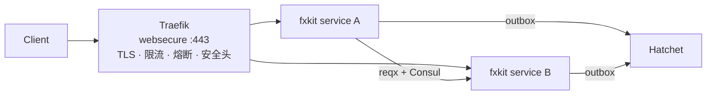

# 南北向网关：Traefik 落地指南

> 适用场景：把 fxkit 服务暴露给浏览器 / App / 第三方。
>
> 一句话分工：**网关负责边缘（TLS、全局限流、路由、WAF），框架负责业务（鉴权、校验、单实例自保）**。
> 两边的限流、超时、body 上限必须对齐，否则会出现「谁先断开算谁的」这类难以排查的问题。

---

## 1. 职责边界

| 能力 | Traefik（南北向） | fxkit（进程内） |
|---|---|---|
| TLS 终止 / 证书轮换 | ✅ ACME 或前置 LB | ❌ |
| 路由 / 灰度 / 权重 | ✅ Consul Catalog + 标签 | ❌（服务只声明自己的路由） |
| 全局限流（跨副本） | ✅ rateLimit 中间件 | ❌（统一在网关做） |
| 真实客户端 IP | ✅（信任链由 `forwardedHeaders` 决定） | ⚠️ 刻意不信任 `X-Forwarded-For` |
| 熔断 / 重试 | ✅ circuitBreaker / retry | ❌（reqx 只做故障转移） |
| 鉴权 / 授权 | ❌ 不适合承载业务 RBAC | ✅ JWT + Casbin |
| 请求校验 | ❌ | ✅ Huma schema |
| 观测 | ✅ access log / metrics / tracing | ✅ OTel（含 trace 传播） |

**结论**：限流统一放在网关/边缘，框架不内置进程内限流；也不要让网关做业务鉴权。

---

## 2. 拓扑



- Traefik 通过 **Consul Catalog** 发现后端（服务自己在 Consul tag 里声明路由）
- 路由规则归**服务**所有：加一个服务不需要改网关配置
- Traefik 只做「执行」：匹配、限流、熔断、转发

---

## 3. 本地开发基线（已在 example 中）

`example/traefik/` 下已有一套可跑的配置：

```
example/traefik/traefik.yml     # entryPoint :80 + Consul Catalog + file provider
example/traefik/dynamic.yml     # 静态页插件 + StripPrefix
example/docker-compose.yml      # traefik 容器，8880 -> :80，8881 -> dashboard
```

服务侧通过 Consul tag 声明路由：

```yaml
# example/services/catalog/configs/config.yaml
discovery:
  register: true
  tags:
    - "traefik.enable=true"
    - "traefik.http.routers.catalog.rule=PathPrefix(`/articles`) || PathPrefix(`/comments`)"
```

这套模式适合本地与内网联调，**不要直接用于公网**（无 TLS、无限流、无安全头）。

---

## 4. 生产配置

参考文件（可直接改域名后使用）：

```
example/traefik/traefik.prod.yml    # 入口、ACME、Consul Catalog、超时
example/traefik/dynamic.prod.yml    # 中间件：安全头 / 限流 / 熔断 / body 上限
```

### 4.1 入口与 TLS

```yaml
entryPoints:
  web:
    address: ":80"
    http:
      redirections:
        entryPoint:
          to: websecure
          scheme: https
          permanent: true

  websecure:
    address: ":443"
    http:
      tls:
        certResolver: le

certificatesResolvers:
  le:
    acme:
      email: ops@example.com
      storage: /acme/acme.json
      httpChallenge:
        entryPoint: web
```

- 前置已有云 LB / Ingress 做 TLS 终止时，**删掉 `websecure` 与 ACME**，只保留 `:80`，并在服务侧把 `entrypoints` 改成 `web`。
- 内网自签或不走公网时，用 `dnsChallenge`，或把证书挂成 file provider。

### 4.2 后端超时（与框架对齐）

```yaml
# 静态配置
serversTransport:
  forwardingTimeouts:
    dialTimeout: 5s
    responseHeaderTimeout: 60s   # 与 fxkit server.read_timeout 对齐
    idleConnTimeout: 90s
```

> **SSE / MCP 例外**：`/mcp/sse` 是长连接，`responseHeaderTimeout` 对首包有效即可；
> 但 entryPoint 的 `writeTimeout` 必须为 0，且该路由**不能挂 buffering 中间件**。

---

## 5. 服务侧：路由标签怎么写

建议把「通用横切」集中在 `dynamic.prod.yml`，服务标签只声明**路由与优先级**。

```yaml
discovery:
  tags:
    - "traefik.enable=true"

    # 业务路由
    - "traefik.http.routers.catalog.rule=PathPrefix(`/articles`) || PathPrefix(`/comments`)"
    - "traefik.http.routers.catalog.entrypoints=websecure"
    - "traefik.http.routers.catalog.tls=true"
    - "traefik.http.routers.catalog.middlewares=sec-headers,catalog-strip,rate-limit-principal,cb,buffered"
    - "traefik.http.routers.catalog.priority=10"

    # MCP / SSE 单独一条：不挂 buffering、不挂 retry，优先级更高
    - "traefik.http.routers.catalog-mcp.rule=PathPrefix(`/mcp`)"
    - "traefik.http.routers.catalog-mcp.entrypoints=websecure"
    - "traefik.http.routers.catalog-mcp.tls=true"
    - "traefik.http.routers.catalog-mcp.middlewares=sec-headers"
    - "traefik.http.routers.catalog-mcp.priority=100"

    # 健康检查：Consul passing 之外的额外保险
    - "traefik.http.services.catalog.loadbalancer.healthcheck.path=/readyz"
    - "traefik.http.services.catalog.loadbalancer.healthcheck.interval=10s"
    - "traefik.http.services.catalog.loadbalancer.healthcheck.timeout=2s"
```

要点：

- **优先级**：`/mcp` 必须先于业务前缀匹配，否则会被 `PathPrefix('/articles')` 之外的规则抢走。
- **中间件名**必须与 `dynamic.prod.yml` 中定义的一致（`sec-headers` / `rate-limit-principal` / `cb` / `buffered`）。
- Consul Catalog provider 默认按 passing 过滤，`/readyz` 健康检查是额外一道。

---

## 6. 四个必配中间件

```yaml
# dynamic.prod.yml
http:
  middlewares:
    sec-headers:
      headers:
        stsSeconds: 31536000
        stsIncludeSubdomains: true
        contentTypeNosniff: true
        frameDeny: true
        referrerPolicy: strict-origin-when-cross-origin

    # 有 API Key 时按 key 限流；没有则按来源 IP
    rate-limit-principal:
      rateLimit:
        average: 200
        burst: 400
        period: 1s
        sourceCriterion:
          requestHeaderName: X-Api-Key

    rate-limit-ip:
      rateLimit:
        average: 100
        burst: 200
        period: 1s

    cb:
      circuitBreaker:
        expression: NetworkErrorRatio() > 0.30 || ResponseCodeRatio(500, 600, 0, 600) > 0.25
        checkPeriod: 10s
        fallbackDuration: 30s
        recoveryDuration: 10s

    buffered:
      buffering:
        maxRequestBodyBytes: 1048576     # 与 server.max_body_bytes 一致
        memRequestBodyBytes: 65536
        maxResponseBodyBytes: 10485760

    retry-idempotent:
      retry:
        attempts: 3
        initialInterval: 100ms
```

约定：

| 中间件 | 适用范围 | 备注 |
|---|---|---|
| `sec-headers` | 所有公网路由 | 含 HSTS，确认全站 HTTPS 后再开 |
| `rate-limit-principal` | 有 API Key 的开放接口 | 无 Key 时退回 `rate-limit-ip` |
| `cb` | 所有后端路由 | 表达式阈值按实测 QPS 调 |
| `buffered` | **仅普通 JSON 路由** | SSE / 上传路由不要挂 |
| `retry-idempotent` | **仅幂等方法** | POST 非幂等不要开 |

---

## 7. 框架侧需要同步的配置

| fxkit 配置 | 生产建议 | 原因 |
|---|---|---|
| `auth.enabled` | `true`，按路由拒绝再开 `casbin.enabled` | 网关不做业务鉴权 |
| `auth.dev_header_user` | `false` | 否则 `X-User` 可绕过 JWT |
| 限流 | 全部在网关/边缘做 | 框架不再内置进程内限流，避免多副本按副本数放大 |
| `server.max_body_bytes` | 与网关 `maxRequestBodyBytes` 一致 | 两侧不一致时较小的生效，返回码不同易误判 |
| `server.cors_allowed_origins` | 显式白名单 | 空 = 不开放 CORS；`*` 仅内部工具 |
| `server.sse_path_prefixes` | 与实际流式路径一致 | 否则 SSE 会被 120s `write_timeout` 掐断 |
| `server.log_payloads` | `false` | 网关侧已有 access log |
| `otel.enabled` | `true` | trace 需要端到端，网关与服务的 `traceparent` 要能串起来 |

---

## 8. 三个必须知道的坑

### 8.1 真实客户端 IP

fxkit 的限流**刻意不信任 `X-Forwarded-For`**（防伪造）。所以：

- 边缘限流必须在网关做（按真实 IP 或 API Key）
- 若服务里需要真实 IP（审计日志），在 Traefik 侧配置信任链：

```yaml
entryPoints:
  websecure:
    forwardedHeaders:
      trustedIPs:
        - 10.0.0.0/8
        - 172.16.0.0/12
        - 192.168.0.0/16
```

> 当前 fxkit 没有「显式信任代理网段后再解析 XFF」的开关。需要的话建议在 handler 层自行解析，
> 而不是改框架默认（默认不信任是更安全的一侧）。

### 8.2 超时不要叠加

三处超时按「外层 ≥ 内层」排列：

```
Traefik entryPoint.writeTimeout  ≥  fxkit server.write_timeout  ≥  业务处理时间
Traefik serversTransport.responseHeaderTimeout  ≈  fxkit server.read_timeout
```

反过来的典型症状：网关先 504，服务日志里却显示请求成功（客户端已断开）。

**SSE/MCP 路由**：`entryPoint.transport.respondingTimeouts.writeTimeout: 0`，
且不挂 `buffering`，否则客户端会「一次性收到整段」而不是流式。

### 8.3 内部端点不要暴露

`/docs`、`/openapi.*`、`/mcp`、`/authz/admin/*`、`/metrics` 不应出现在公网路由里。

两种做法（选一）：

```yaml
# A. 不配公网路由（最干净）
#    只给业务前缀配 router

# B. 显式内网白名单
    internal-only:
      ipAllowList:
        sourceRange:
          - 10.0.0.0/8
          - 192.168.0.0/16
```

另外记得：`docs.enabled` / `mcp.enabled` 默认就是 `false`，生产按需开启。

---

## 9. 验收清单

```bash
GW=https://gw.example.com

# 1) HTTP → HTTPS
curl -sI http://gw.example.com/articles | grep -i location

# 2) 安全头
curl -sI "$GW/articles" | grep -iE "strict-transport-security|nosniff|referrer-policy"

# 3) 限流（超过 average+burst 应出现 429）
for i in $(seq 1 500); do curl -s -o /dev/null -w "%{http_code}\n" "$GW/articles"; done | sort | uniq -c

# 4) 请求体上限（>1MiB 应 413）
head -c 2000000 /dev/zero | curl -s -o /dev/null -w "%{http_code}\n" \
  -X POST --data-binary @- -H 'Content-Type: application/json' "$GW/articles"

# 5) 内部端点不可达
curl -s -o /dev/null -w "%{http_code}\n" "$GW/docs"       # 期望 403/404
curl -s -o /dev/null -w "%{http_code}\n" "$GW/openapi.yaml"

# 6) SSE 流式不被缓冲（应逐条到达；Ctrl-C 结束）
curl -N -H 'Accept: text/event-stream' "$GW/mcp/sse"

# 7) 故障实例被摘除（kill 一个副本，观察 502/504 是否在 ~10s 内消失）
```

---

## 10. 常见故障对照

| 症状 | 可能原因 | 排查 |
|---|---|---|
| 502 Bad Gateway | 后端未就绪 / Consul 未 passing / 端口不匹配 | Traefik dashboard 看 service 的 servers 列表；`curl` 服务 `/readyz` |
| 504 Gateway Timeout | `responseHeaderTimeout` 小于业务耗时 | 对齐第 8.2 节的三处超时 |
| 全部请求 429 | 网关限流配置过严 | 调整网关 rateLimit 规则 |
| SSE 一次性吐出 | 路由挂了 `buffering` | 给流式路由单独建 router，去掉 buffering |
| SSE 120s 断开 | `server.sse_path_prefixes` 未覆盖 | 补前缀，或调大 `write_timeout` |
| 路由 404 | Consul tag 未生效 / `exposedByDefault: false` 且缺 `traefik.enable=true` | `consul catalog services` 看标签是否带上了 |
| 灰度失效 | 所有副本 tag 相同、无权重 | Traefik 不支持按实例权重；用两套服务名或 weighted service |

---

## 11. 与框架内其他组件的关系

- **服务发现**：Traefik 与服务**共用** Consul；服务注册用 `discovery.register: true`（见 README §15）
- **服务间调用**：走 `reqx`（Consul + 故障转移），**不经过** Traefik；南北与东西是两条路径
- **可观测性**：Traefik 的 access log / trace 与 fxkit 的 OTel 输出到同一个 collector，靠 `traceparent` 串联
- **异步**：outbox → Hatchet 属于业务链路，与网关无关

---

## 12. 上线顺序建议

1. 先按 `dynamic.prod.yml` 把中间件配好，路由仍走内网 HTTP
2. 打开 `websecure` + ACME，观察证书签发
3. 服务侧把 router 的 `entrypoints` 切到 `websecure`，验证 HTTPS 与 HSTS
4. 打开边缘限流，观察 429 比例
5. 打开熔断，人为 kill 一个副本验证摘除
6. 最后收紧密集：不配公网路由的内部端点、`auth.enabled=true`、关闭 `log_payloads`
