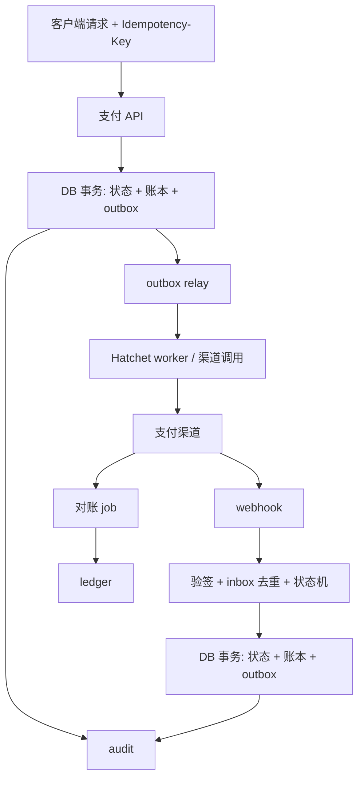

# 支付业务使用指南（fxkit）

> 适用：用 fxkit 做支付、订单、账务、结算类服务。
> 目标：把“重复、丢事件、并发覆盖、余额算错、渠道对不上”变成可设计、可测试、可对账的问题。

## 0. 一句话模型

> **正确性 = 幂等 + 状态机（CAS） + 复式记账 + Outbox/Inbox + 对账 + 审计**

框架提供原语；支付渠道、费率、退款规则、结算周期由业务服务定义。

---

## 1. CAS 是什么

CAS = **Compare-And-Swap / Compare-And-Set**：先比较期望值，再原子更新。

数据库里的典型形式：

```sql
UPDATE payments
SET status = 'authorized', version = version + 1
WHERE id = 'p1' AND status = 'created' AND version = 1;
```

- `RowsAffected = 1`：更新成功
- `RowsAffected = 0`：状态或版本已被别人改过 → 返回 409

它不是悲观锁（`SELECT ... FOR UPDATE`），不会阻塞；它是**乐观并发控制**。

fxkit 里的 CAS：

```go
err := gormx.UpdateWithVersion(ctx, db, &payment, "state")
// version 不匹配 -> fxerrors.Conflict -> HTTP 409
```

支付状态流转建议统一走：

```go
err := payment.Apply(ctx, db, machine, &payment, payment.StateAuthorized)
```

---

## 2. 正确性模型



关键原则：

1. **所有网络调用都可能重复**：至少一次投递 + 幂等处理
2. **所有状态变更都走 CAS**：不允许裸 `UPDATE status`
3. **所有资金变更都走 ledger**：不允许直接改 balance
4. **业务写入与事件发布同事务**：outbox
5. **消费去重**：inbox
6. **最终兜底**：对账 + 审计

---

## 3. 原语包

| 包 | 作用 |
|---|---|
| `money` | 最小货币单位金额、币种校验、加减比较 |
| `ledger` | 复式记账事务、分录、余额 |
| `payment` | 状态机 + CAS 流转 |
| `webhook` | HMAC 验签、时间戳容忍、原始 body |
| `reconciliation` | 内部/外部记录对账 |
| `outbox` / `inbox` | 事务性事件 + 消费去重 |
| `idempotency` | HTTP 幂等键 + 响应重放 |
| `audit` | 操作审计 |

---

## 4. Money：不要用 float

```go
amount, err := money.New(1999, "CNY") // 19.99 元
if err != nil { ... }

fee := amount.Mul(3) // 5997
total, err := amount.Add(fee)
```

约定：

- `Amount int64` 是最小货币单位（分）
- `Currency` 是 ISO 4217 三字母代码
- 不同币种不能直接相加/比较
- 金额只在服务端计算，不信任客户端

---

## 5. Ledger：复式记账

### 5.1 模型

- `ledger_accounts`：账户
- `ledger_transactions`：一次记账事务
- `ledger_postings`：分录，`Amount` 有符号

同一事务内，按币种求和必须为 0：

```text
payment: p1, 100 CNY
  cash            +100
  merchant_payable -100
```

### 5.2 记账

```go
l := ledger.New(db)

err := l.Post(ctx, ledger.Transaction{
    ID:        "payment:p1:authorized",
    Reference: "p1",
}, []ledger.Posting{
    {AccountID: "cash", Amount: 100, Currency: "CNY"},
    {AccountID: "merchant_payable", Amount: -100, Currency: "CNY"},
})
```

- 事务 ID 必须唯一；重复记账返回冲突
- 借贷不平衡、金额为 0、币种非法都会拒绝
- 分录只追加，不 update/delete

### 5.3 余额

```go
bal, err := l.Balance(ctx, "cash", "CNY")
```

余额由分录聚合；如果业务缓存余额，必须能通过 ledger 重算并定期校验。

### 5.4 与业务事务

`Ledger.Post` 内部使用 `db.WithTxResult`，会加入外层事务。建议：

```go
err := db.WithTxResult(ctx, func(txCtx context.Context) (Payment, error) {
    // 1. CAS 状态
    // 2. ledger.Post(txCtx, ...)
    // 3. outbox.EnqueueTopicMsg(txCtx, ...)
})
```

这样“状态 + 资金 + 事件”要么都成功，要么都回滚。

---

## 6. Payment 状态机

```go
var machine = payment.NewMachine(
    payment.Transition{From: "created", To: "authorized"},
    payment.Transition{From: "authorized", To: "captured"},
    payment.Transition{From: "captured", To: "settled"},
    payment.Transition{From: "created", To: "failed"},
    payment.Transition{From: "authorized", To: "failed"},
    payment.Transition{From: "captured", To: "refunded"},
)
```

实体要求：

```go
type Payment struct {
    ID      string `gorm:"primaryKey"`
    State   string `gorm:"size:32;not null"` // 列名必须是 state
    Version int64  `gorm:"not null;default:1"`
}

func (p *Payment) PaymentState() payment.State     { return payment.State(p.State) }
func (p *Payment) SetPaymentState(s payment.State) { p.State = string(s) }
func (p *Payment) GetVersion() int64               { return p.Version }
func (p *Payment) SetVersion(v int64)              { p.Version = v }
```

流转：

```go
if err := payment.Apply(ctx, db, machine, &p, "authorized"); err != nil {
    return err // 非法 transition 或 version conflict -> 409
}
```

- 非法 transition → `409`
- version 不匹配 → `409`
- 不会覆盖别人的并发更新

---

## 7. HTTP 幂等 + 渠道幂等

### 7.1 客户端请求

```yaml
idempotency:
  enabled: true
  header: "Idempotency-Key"
  ttl: 24h
  store: "db"
```

- 前端在用户点击“支付”时生成 UUID
- 同一次业务操作的所有重试复用同一个 key
- 服务端重放第一次响应，不重复扣款

### 7.2 渠道幂等键

调用 Stripe/Adyen 等渠道时，使用**内部支付 ID**派生渠道幂等键：

```go
providerKey := "pay_" + payment.ID
```

- 重试时**不要重新生成**
- 渠道超时后重试，渠道侧按同一个 key 去重
- 如果渠道不支持幂等键，必须用查询/对账补偿

---

## 7.1 ID 生成

- 不要手写随机 hex；用成熟库。
- 需要类型前缀时用 **TypeID**（`go.jetify.com/typeid`）：`pay_ + Base32(UUIDv7)`，30 字符，时间有序。示例的支付单使用它。
- 不需要前缀时用 UUIDv7 即可。
- 前缀不增加碰撞空间；碰撞概率与排序性由底层 UUIDv7 决定，与字符串格式无关。
- 支付 ID 生成一次，重试复用；渠道幂等键直接用它。
- 存 `BINARY(16)` 时注意：TypeID 解码会丢掉前缀，需把 type 纳入主键或单独存类型列。

---

## 8. Outbox / Inbox 事件 key

`IdempotencyKey` 是“事件实例 ID”，不是实体 ID。

| 事件 | Key |
|---|---|
| 创建支付 | `payment-created:{paymentID}` |
| 状态变更 | `payment:{paymentID}:{from}->{to}:v{version}` |
| 退款 | `refund:{refundID}` |
| 对账修复 | `reconcile:{date}:{diffKey}` |
| 可重复的“重发通知” | 每次生成新的 `notificationID` |

生产：

```go
outbox.EnqueueTopicMsg(txCtx, outbox.EnqueueTopicInput[PaymentEvent]{
    Store: store,
    Topic: "payment.authorized",
    Msg:   ev,
    IdempotencyKey: fmt.Sprintf("payment:%s:authorized:v%d", p.ID, p.Version),
})
```

消费：

```go
return inbox.Once(ctx, outbox.OnceInput{
    Key:   ev.IdempotencyKey, // 与生产端一致
    Topic: "payment.authorized",
    Fn:    handle,
})
```

如果事件本来就允许重复且 handler 幂等，可以不设 key（`inbox.Once` 空 key 每次执行）。

---

## 9. Webhook

```go
v := webhook.Verifier{
    Secret:    []byte(secret),
    Tolerance: 5 * time.Minute,
}

raw, err := webhook.ReadBody(r, 1<<20)
if err != nil { ... }
if err := v.VerifyRequest(r, raw); err != nil {
    // 验签失败 -> 401
    return err
}
// 1. 解析 raw
// 2. 用 provider event ID 调 inbox.Once 去重
// 3. 状态机 CAS 流转
// 4. 写 ledger + outbox
// 5. 返回 2xx
```

原则：

- 必须用**原始 body** 验签，不要先反序列化再序列化
- 时间戳超出容忍窗口拒绝（防重放）
- 先持久化再 ack；失败返回非 2xx 让渠道重试
- 用 `inbox.Once(providerEventID)` 去重
- 乱序事件交给状态机/version 拒绝

---

## 10. 对账

```go
diffs, err := reconciliation.Run(ctx, reconciliation.Comparator[Row]{
    Internal: loadLedgerRows,
    External: loadProviderSettlement,
    Key:      func(r Row) string { return r.PaymentID },
    Equal:    func(a, b Row) bool { return a.Amount == b.Amount && a.Currency == b.Currency },
})
```

差异类型：

- `missing_external`：内部有、渠道没有
- `missing_internal`：渠道有、内部没有
- `mismatch`：金额/币种/状态不一致

建议：

- 用 Hatchet Cron 每日/每小时跑
- 差异写 `reconciliation_diffs` 表（业务表）
- 告警 + 人工/自动幂等修复
- 修复任务本身也要有唯一 key

---

## 11. 审计

`audit.Module` 记录：

- 谁（Actor/OrgID）
- 何时
- 对哪个支付单
- 做了什么
- 请求 ID / Trace ID

支付场景建议：

- 审计 sink 用 DB 或 outbox，便于长期保留
- 关键状态变更同时写业务审计表
- 不要把 PAN/CVV/token 写进审计

## 11.1 提交后副作用

- 事务内调 `gormx.AfterCommit(txCtx, fn)` 做提交后副作用（日志/指标/缓存失效）；回滚不执行，回调 context 不带事务句柄。
- repository 放共享 `internal/repository/payment.go`，对账、报表等其它 feature 可直接复用。
- 多租户隔离模型已移除；框架默认单租户。需要隔离时在数据层单独设计（RLS / 独立 schema / 独立实例）。

## 11.2 部分退款

- `payments` 记录 `captured_amount` / `refunded_amount`；退款单放 `payment_refunds`。
- `Refund(amount)` 支持多次调用；省略金额时退剩余额度。
- 超额退款拒绝；累计退款不能超过已捕获金额。
- 每次退款使用独立账本事务 `payment:<id>:refunded:<refundID>`，重复请求由幂等键/退款 ID 拦截。
- 退完才转 `refunded`；部分退款时状态保持 `captured`。

---

## 12. 端到端流程

```text
1. POST /payments
   - Idempotency-Key
   - 校验金额/币种/商户
   - 创建 payment(status=created, version=1)
   - 同事务 outbox: payment.created

2. Worker 调渠道
   - 渠道幂等键 = pay_{paymentID}
   - 成功: CAS created -> authorized
           ledger.Post(cash +100 / payable -100)
           outbox payment.authorized
   - 失败: CAS created -> failed
           outbox payment.failed

3. Webhook
   - 验签 + 时间戳
   - inbox.Once(providerEventID)
   - CAS 状态流转
   - ledger + outbox
   - 2xx

4. 对账
   - 渠道 settlement vs ledger
   - 差异告警 + 幂等修复

5. 审计
   - 每次状态变更/资金变更
```

---

## 13. 安全 / PCI

- 不存 PAN/CVV；用渠道 tokenization
- 密钥走 secret manager，不进配置文件/日志
- Webhook 验签 + 时间戳容忍
- 最小权限：支付服务只能访问自己的库/密钥
- 审计脱敏；`audit.include_body` 默认关闭
- 生产关闭 `auth.dev_header_user`
- 支付相关接口单独限流（per-merchant/per-route）

---

## 14. 测试重点

- 并发同 `Idempotency-Key` 只执行一次
- 同事件重复投递只处理一次
- 旧 version / 非法 transition 返回 409
- 渠道超时后重试不重复扣款
- Webhook 重复/乱序/伪造签名
- Ledger 每笔 transaction 金额和为 0
- 对账发现漏单/重复/金额不一致
- 故障注入：
  - 事务提交后、outbox 前崩溃
  - 渠道成功后、状态更新前崩溃
  - webhook 处理中崩溃

---

## 15. 反模式

- ❌ 用 float 存金额
- ❌ 直接 `UPDATE balance = balance - 100`
- ❌ 直接 `UPDATE status`，不走 CAS
- ❌ 用实体 ID 作为所有事件的 IdempotencyKey
- ❌ 在 DB 事务里调支付渠道
- ❌ 渠道重试时重新生成幂等键
- ❌ Webhook 先反序列化再验签
- ❌ 不做对账，只依赖 webhook
- ❌ 用 `time.Now()` 做幂等键
- ❌ 声称 exactly-once；正确目标是 at-least-once + 幂等

---

## 16. 表与迁移

框架新增 ledger 表：

| 表 | 用途 |
|---|---|
| `ledger_accounts` | 账户 |
| `ledger_transactions` | 记账事务 |
| `ledger_postings` | 分录 |

DDL：

```bash
myapp migrate print --dialect postgres --version 0006
myapp migrate check -c configs/config.yaml
```

`ledger.Module` 会登记 schema contract；启用后 `migrate check` 会校验这三张表。

---

## 17. 框架能力对照

| 需求 | fxkit |
|---|---|
| 金额 | `money` |
| 复式记账 | `ledger` |
| 状态机 + CAS | `payment` + `gormx.UpdateWithVersion` |
| HTTP 幂等 | `idempotency` |
| 事件 outbox/inbox | `outbox` |
| Webhook 验签 | `webhook` |
| 对账 | `reconciliation` |
| 审计 | `audit` |
| 分布式锁 | `consulx`（含 fencing token） |
| 幂等 | `idempotency` |
| 限流 | 网关/边缘（框架不内置） |

---

## 18. 最小接入清单

- [ ] 金额用 `money`
- [ ] 资金变更走 `ledger.Post`
- [ ] 状态变更走 `payment.Apply`
- [ ] 支付接口开 `idempotency`
- [ ] 事件用 outbox，消费用 inbox
- [ ] 渠道调用用稳定幂等键
- [ ] Webhook 验签 + 去重 + 状态机
- [ ] 每日对账
- [ ] 审计关键操作
- [ ] 并发/重试/故障注入测试
